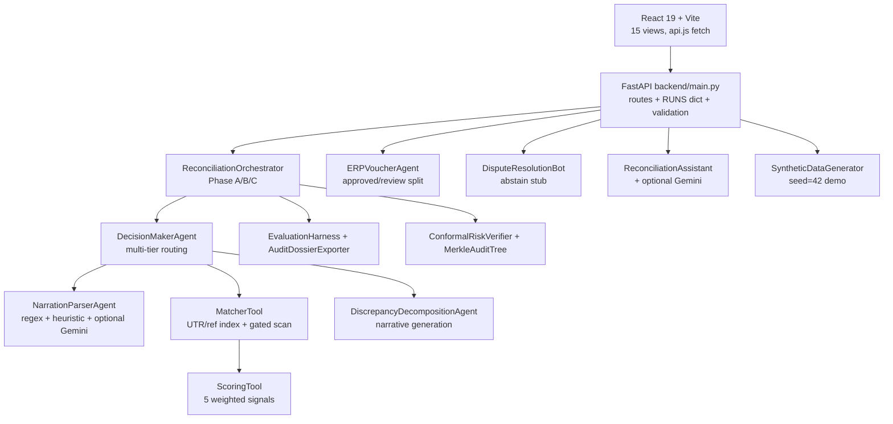
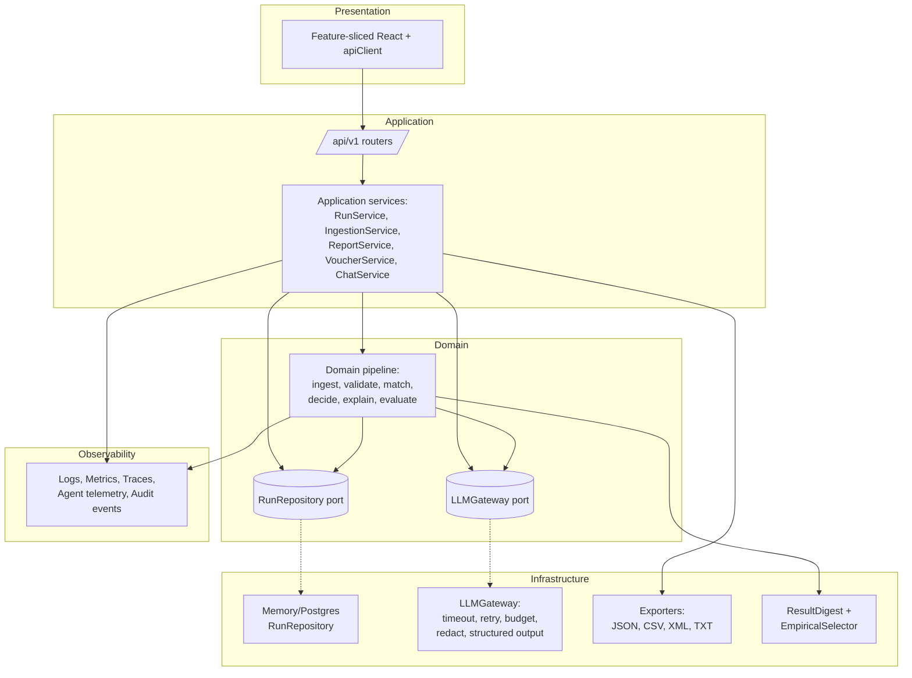
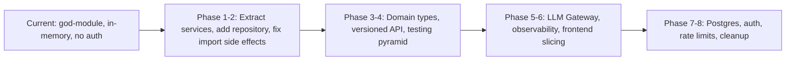
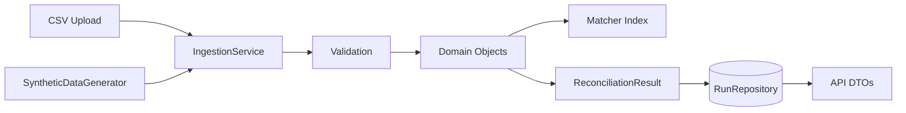
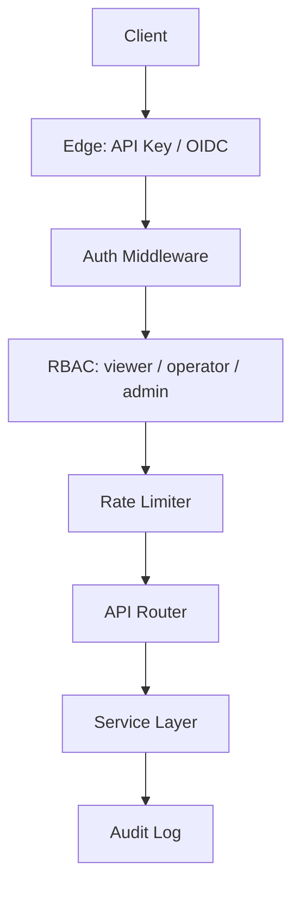
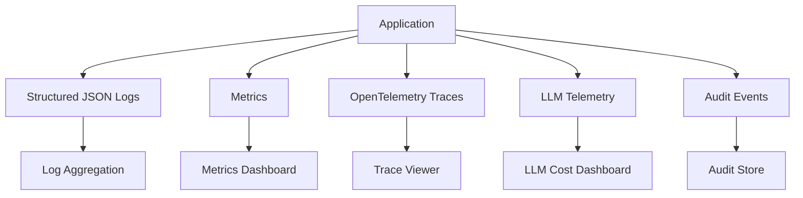
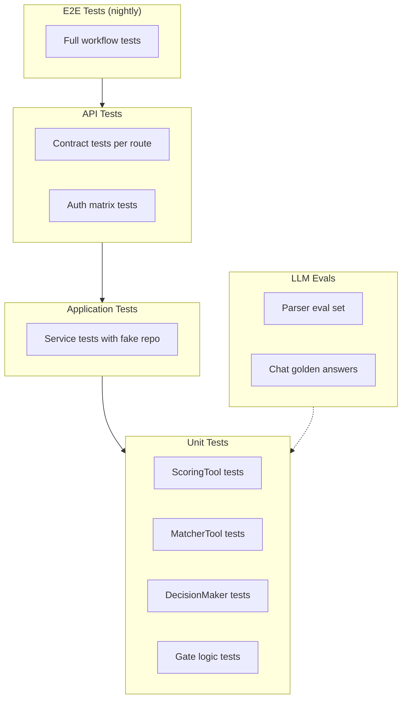

# CODEBASE DEEP ANALYSIS — ReconX Architecture Modernization Blueprint

> **Location:** `E:\PROJECTS\razorpay\CODEBASE_DEEP_ANALYSIS.md`
> **Scope:** Backend (FastAPI + engine + agents), Frontend (React/Vite), data fixtures, tests, `render.yaml`, docs/README.
> **Method:** [OBSERVED] = read directly from source. [INFERRED] = reasonable deduction from code. [RECOMMENDED] = proposal. [UNVERIFIED] = could not verify.
> **Constraint:** READ-ONLY analysis. No application code was modified to produce this document.

---

## Table of Contents

1. [Executive Summary](#1-executive-summary)
2. [Current Architecture](#2-current-architecture)
3. [Findings](#3-findings)
4. [Architectural Modernization](#4-architectural-modernization)
5. [Boundary Design](#5-boundary-design)
6. [Dependency Direction](#6-dependency-direction)
7. [AI/Agent Architecture Modernization](#7-aiagent-architecture-modernization)
8. [Data Architecture](#8-data-architecture)
9. [API Architecture Modernization](#9-api-architecture-modernization)
10. [Frontend Architecture Modernization](#10-frontend-architecture-modernization)
11. [Security Modernization](#11-security-modernization)
12. [Observability Architecture](#12-observability-architecture)
13. [Testing Architecture](#13-testing-architecture)
14. [Performance Architecture](#14-performance-architecture)
15. [Production Readiness](#15-production-readiness)
16. [Target Architecture](#16-target-architecture)
17. [Target Directory Structure](#17-target-directory-structure)
18. [Migration Roadmap](#18-migration-roadmap)
19. [Decision Records](#19-decision-records)
20. [Verification](#20-verification)

---

## 1. Executive Summary

[OBSERVED] ReconX is a modular-monolith demo system for the Razorpay Buildathon 2026 (Track 04: AI Finance Controller). It reconciles bank statements, internal ledgers, and network settlement reports for Indian payment aggregators. The system features:

- **Backend:** Python 3.10+, FastAPI, Pydantic v2, pandas, numpy, scikit-learn, scipy, rapidfuzz
- **Frontend:** React 19, Vite 6, Framer Motion, lucide-react, react-markdown
- **AI/LLM:** Google Gemini 2.5 Flash (optional, with rule-based fallback)
- **Deployment:** Render.com (blueprint)
- **Data:** In-memory only (no database persistence)

[OBSERVED] The deterministic matching engine is well-designed: O(1) inverted index on UTR/invoice, 5-channel weighted scoring, 1:1 claiming mutex, ambiguity quarantine, and SHA-256 Merkle tree for result integrity. The system correctly abstains from guessing when evidence is insufficient.

[OBSERVED] The codebase has significant architectural debt: a 765-line god-module (`backend/main.py`), in-memory state with no persistence, no authentication, no API versioning, no structured observability, and an AI/agent layer with three separate Gemini clients, inline prompts, and no budgets or timeouts.

[RECOMMENDED] Target: **modular monolith + pipeline/workflow architecture** with strict layering (Presentation -> Application -> Domain -> Infrastructure), deterministic core isolated from optional LLM assistance, persisted run store behind a repository interface, versioned API routers, feature-sliced frontend, and evaluable agent/tool boundaries. Do NOT move to microservices.

---

## 2. Current Architecture



[OBSERVED] Data lifecycle: `SyntheticDataGenerator(seed=42)` -> DataFrames -> `_sanitize_df` -> `MatcherTool` indexes -> `score_pair` -> `DecisionMakerAgent` claim-once -> `ReverseSweepTool` -> Merkle root + empirical threshold (only with ground_truth) -> `SummaryResponse` -> JSON/CSV/XML/TXT. Uploads return 503 (`main.py:267-271`); synthetic runs only.

[OBSERVED] The system seeds a demo run at import time (`main.py:204-233`), which blocks startup and test collection.

---

## 3. Findings

### F-01 — `backend/main.py` god-module (765 lines)

#### Finding
HTTP routing, request validation, session lifecycle, pipeline invocation, and export formatting all live in a single module.

#### Evidence
- [OBSERVED] `backend/main.py:1-765`: `RunSession` class, `RUNS` dict, `init_default_demo_run()` at import, `_normalize_uploaded_frame`, `_escape_csv_formula_value`, 15+ API routes.
- [OBSERVED] `import backend.main` hangs >30s due to eager demo pipeline execution.
- [OBSERVED] `TestClient(app)` collection hangs because import triggers full pipeline.

#### Root Cause
No application layer existed; demo endpoints accumulated session handling, validation, and orchestration in the fastest place -- the HTTP module -- coupling presentation concerns to domain logic.

#### Impact
- **Maintainability:** Low. Any change to matching logic risks breaking HTTP routes.
- **Testability:** Low. Cannot unit-test routes without importing the full pipeline.
- **Developer velocity:** Slow imports hurt iteration speed.
- **Reliability:** A bug in any route can crash the entire application.

#### Severity
High

#### Recommended Engineering Solution
Layered modular monolith: `api/routers/*.py` (thin) -> `application/run_service.py`, `report_service.py`, `voucher_service.py` -> `domain/*` -> `infrastructure/run_repository.py`, `llm_gateway.py`. Move `RUNS` behind a repository interface; move demo seeding to a lifespan hook with a flag.

#### Target Design
Routers parse/validate/serialize only. Services own locking and lifecycle. Domain owns matching math and never imports FastAPI.

#### Migration Strategy
Current -> extract `RunRepository` + `RunService` for status/summary -> redirect 2 routes -> contract tests green -> extract reports/vouchers/disputes -> leave route registration in `main.py`.

#### Risks of the Proposed Solution
Route behavior drift; lock-semantics change; demo-run tests depend on import seeding.

#### Validation Strategy
API contract tests per route; import-time test (`import app` <2s, no pipeline); duplicate-run 409 concurrency test; demo-run count regression.

---

### F-02 — In-memory `RUNS` dict: no persistence, no eviction

#### Finding
Restarts lose all run data; memory grows with row limits; multi-worker unsafe despite `threading.Lock`.

#### Evidence
- [OBSERVED] `backend/main.py:174-201`: `RunSession` holds DataFrames + results; `RUNS` dict is module-level.
- [OBSERVED] `backend/main.py:199`: `threading.Lock` per session, but no cross-process safety.
- [OBSERVED] `render.yaml`: free tier = single worker, but this is an implementation detail, not a guarantee.

#### Root Cause
Demo-first store; Phase-2 DB deferred per README roadmap.

#### Impact
- **Reliability:** Data loss on restart or crash.
- **Scalability:** Cannot scale horizontally; unbounded memory growth.
- **Multi-tenancy:** No isolation between users.

#### Severity
High

#### Recommended Engineering Solution
Repository pattern: `RunRepository` port with memory adapter now, Postgres later. Add TTL/eviction + run manifest.

#### Target Design
`RunService -> RunRepository -> {Memory | Postgres}`. Domain never sees the dict.

#### Migration Strategy
Interface -> memory impl over current dict -> redirect call sites one router at a time -> add Postgres adapter behind flag.

#### Risks of the Proposed Solution
DataFrame/Pydantic serialization; demo-run expectation churn.

#### Validation Strategy
Repository unit tests; restart-recovery test; memory-bound test; concurrent-claim test.

---

### F-03 — Import-time pipeline blocks startup and tests

#### Finding
Module import runs generation + full pipeline; every API test pays that cost.

#### Evidence
- [OBSERVED] `backend/main.py:204-233`: `init_default_demo_run()` called at module level.
- [OBSERVED] `import backend.main` timed out >30s during analysis.

#### Root Cause
Seeding as module side effect instead of lifespan event.

#### Impact
- **Velocity:** Slow imports, hanging collection, slower cold start.
- **Testability:** Cannot collect tests without running the pipeline.

#### Severity
High

#### Recommended Engineering Solution
FastAPI lifespan handler with `RECONX_SEED_DEMO` flag; lazy seed on first demo-run access.

#### Target Design
`lifespan -> config -> optional seed job -> ready`. Tests import app instantly.

#### Migration Strategy
Add lifespan + flag -> keep eager default -> flip default after API tests pass -> delete eager call.

#### Risks of the Proposed Solution
Demo-run tests assuming seeded state.

---

### F-04 — Disabled batch matcher + stale batch surface (silent recall loss)

#### Finding
`BatchSettlementTool.check_batch_settlement` always returns `None`, but call sites, schema fields, and discrepancy enums still advertise batch support.

#### Evidence
- [OBSERVED] `backend/engine/matcher.py:213-229`: returns `None` unconditionally.
- [OBSERVED] Callers at `decision_maker_agent.py:142,379`.
- [OBSERVED] `schemas.py:93`: `matched_ledger_ids` field exists for batch.
- [OBSERVED] `orchestrator.py:184-195`: counts `batch_settlement` in discrepancy breakdown.

#### Root Cause
Sum-based batch matcher was removed as unsafe (amount sums do not prove identity) without removing its interface.

#### Impact
- **Correctness clarity:** Improved (no false batch claims).
- **Recall:** Down if fixtures expect N:1 matching.
- **Dead code:** Misleading trace text and unused code paths.

#### Severity
High

#### Recommended Engineering Solution
Make batch a first-class workflow state: require an authoritative membership key (settlement-member relation) before any N:1 claim; otherwise emit `candidate_ambiguity` with needed key named. Keep gate closed until key exists.

#### Target Design
`UTR hit -> membership-key check -> single-key batch claim (atomic) | else abstain`. No sum-only claims.

#### Migration Strategy
Document gate -> add settlement-membership fixture -> implement keyed batch behind flag -> validate on synthetic N:1 -> remove dead call text.

#### Risks of the Proposed Solution
False batches if key is weak; ground-truth mismatch during transition.

#### Validation Strategy
N:1 fixture tests (keyed match, missing key abstains, multi-solution abstains); no-claim invariant tests; match-rate delta report.

---

### F-05 — No-UTR score rescaling (`1/0.55`) gated by fuzzy thresholds

#### Finding
No-UTR pairs are rescored over remaining channels; the only guard is `decision_maker_agent.py:285-292` ref/name/amount/date gates that include fuzzy ref scores.

#### Evidence
- [OBSERVED] `backend/engine/scorer.py:240-246`: rescaling formula.
- [OBSERVED] `decision_maker_agent.py:274-294`: evidence gates.

#### Root Cause
Fixed-weight sum made no-UTR matches impossible; rescaling restored them without separating exact-identity evidence from fuzzy similarity.

#### Impact
- **Reliability:** Narration-similar rows can cross 0.75 threshold.
- **Ambiguity rule:** The backstop, but not a substitute for proper gating.

#### Severity
High

#### Recommended Engineering Solution
Split scoring into identity evidence (exact UTR / exact ref / keyed membership) vs similarity features; require at least one identity signal or two independent high similarities + amount + date; log which gate passed.

#### Target Design
`score = identity_gate AND similarity_score`; abstain with named missing evidence otherwise.

#### Migration Strategy
Add gate telemetry -> tighten to exact-ref-or-dual-similarity -> run fixture delta -> pin with tests.

#### Risks of the Proposed Solution
Recall drop on weak narrations.

#### Validation Strategy
No-UTR fixture matrix; gate-pass logging; precision/recall before-after.

---

### F-06 — Dead heavy objects in hot path

#### Finding
Decision maker builds tensor/graph engines but never calls them; trace still says "3D tensor".

#### Evidence
- [OBSERVED] `decision_maker_agent.py:46-61`: constructs `HybridTensorEngine` and `BipartiteGraphSolver`.
- [OBSERVED] Trace lines 249, 319: reference "3D tensor" and "tensor core".
- [OBSERVED] `vector_tensor.py` and `graph_solver.py` are never invoked in the production path.

#### Root Cause
Research harness left wired into production coordinator.

#### Impact
- **Startup/memory:** Unnecessary object construction.
- **Misleading traces:** Users believe tensor engine is being used.
- **Maintenance:** Dead code confuses developers.

#### Severity
Medium

#### Recommended Engineering Solution
Remove from decision path; move to `research/` offline CLI; fix trace strings.

#### Target Design
`DecisionMaker(matcher, scorer, narration)`; research standalone.

#### Migration Strategy
Remove construction -> update traces -> move files -> repoint tests.

#### Risks of the Proposed Solution
Breaking research imports.

#### Validation Strategy
Import-graph test; startup timing; trace assertions.

---

### F-07 — Stale guarantee names + precision default

#### Finding
Names promise conformal/ZK/solvency; code does empirical + plain SHA-256. Empty predictions report precision 1.0.

#### Evidence
- [OBSERVED] `conformal_verifier.py:1-21,69-73`: class named `ConformalRiskVerifier` but docstring says "does not provide a conformal finite-sample guarantee."
- [OBSERVED] `schemas.py:189`: `conformal_calibrated_threshold` field.
- [OBSERVED] `audit_exporter.py:97`: `precision = 1.0` when no predictions.

#### Root Cause
Logic hardened; names/schemas kept for compatibility.

#### Impact
- **Trust/compliance:** Misleading terminology.
- **API consumers:** `.precision` alone misreads (flag exists but callers may ignore it).

#### Severity
High

#### Recommended Engineering Solution
Rename to `EmpiricalThresholdSelector` + `ResultDigestTree`; deprecate old field one release; empty precision -> `None` + flag; UI must branch on flag.

#### Target Design
`empirical_selected_threshold`, `result_digest`; no guarantee language in outputs.

#### Migration Strategy
New names -> dual-write -> migrate consumers -> remove old.

#### Risks of the Proposed Solution
Breaking summary-JSON consumers.

#### Validation Strategy
Banned-term grep tests; schema-compat tests; UI flag tests.

---

### F-08 — No auth; uploads disabled as only guard

#### Finding
Any client can create runs, recompute, download; only upload protection is a 503.

#### Evidence
- [OBSERVED] `main.py:248-271`: 503 on file uploads.
- [OBSERVED] No auth middleware in the application.
- [OBSERVED] `render.yaml`: public Render demo URL.

#### Root Cause
Demo-first; auth deferred.

#### Impact
- **Security:** Public URL exposes run creation + exports.
- **Uploads:** Cannot safely reopen without auth.

#### Severity
Critical

#### Recommended Engineering Solution
Edge API-key/OIDC -> roles (viewer/operator/admin) -> per-run ownership; signed downloads; uploads for operators only with quotas.

#### Target Design
Edge auth -> scope -> service policy -> audit log. Anonymous gets synthetic demo only.

#### Migration Strategy
Auth middleware + demo-anonymous role -> scope routes -> ownership -> gate uploads -> audit exports.

#### Risks of the Proposed Solution
Demo lockout; secret rotation.

#### Validation Strategy
Auth matrix (401/403); ownership; quota; secret-scan CI.

---

### F-09 — Validation split-brain: strict normalizer is dead code

#### Finding
`_normalize_uploaded_frame` is thorough but unreachable (503 first); unit tests cover it, API never runs it.

#### Evidence
- [OBSERVED] `main.py:82-163`: normalizer with 80+ lines of validation.
- [OBSERVED] `main.py:267-271`: reject-before-parse.
- [OBSERVED] `test_api.py:142-168`: direct unit tests for normalizer.

#### Root Cause
Uploads disabled without removing or reusing the validation path.

#### Impact
- **False confidence:** Tests pass but API never exercises the code.
- **Dead code:** The `else` branch (280-300) is unreachable.

#### Severity
Medium

#### Recommended Engineering Solution
Single `ingestion` application service: parse -> validate -> normalize -> persist manifest. Keep 503 as policy decision inside service, not route short-circuit, so re-enable is one flag.

#### Target Design
`UploadController -> IngestionService.validate -> RunRepository.create`. Unit + API tests share fixtures.

#### Migration Strategy
Extract service -> route calls service -> keep deny-policy -> add operator-enabled flag later.

#### Risks of the Proposed Solution
Validation-error shape changes.

#### Validation Strategy
Shared bad-CSV fixture matrix (unit + API); error-contract tests.

---

### F-10 — AI/agent architecture: 3 Gemini clients, prompt-in-code, no budgets

#### Finding
`NarrationParserAgent`, `DiscrepancyDecompositionAgent`, `ReconciliationAssistant` each init Gemini separately; prompts are inline f-strings; no timeouts/retries/token budgets; narration LLM is last-resort after regex+heuristic (good) but still unguarded.

#### Evidence
- [OBSERVED] `narration_parser_agent.py:25-36,66-95,114-146`: Gemini client init and inline prompt.
- [OBSERVED] `discrepancy_agent.py:20-35`: class-level Gemini client (initialized but not actively used).
- [OBSERVED] `assistant_agent.py:20-33`: separate Gemini client with 4-model fallback chain.

#### Root Cause
LLM added per-agent without a shared gateway; deterministic fallback order evolved correctly but cross-cutting concerns never extracted.

#### Impact
- **Reliability:** Unbounded latency, no retry logic.
- **Cost:** No token budgets or cost controls.
- **Security:** PII egress risk (narration text sent to external API).
- **Maintainability:** Prompt drift across agents.

#### Severity
High

#### Recommended Engineering Solution
One `LLMGateway` port (timeout, retry w/ backoff, budgets, redaction, structured-output validation). Deterministic-first: regex -> heuristic -> LLM-parse (optional flag) for narrations; LLM only drafts chat summaries from computed analytics, never decides matches. Add eval set + prompt versioning.

#### Target Design
`Agents -> LLMGateway -> provider`; `parse()` returns typed `{name, ref, method, confidence}`; chat answers cite record IDs from analytics, not model memory.

#### Migration Strategy
Extract gateway -> redirect narration parser -> redirect assistant -> add evals/budgets -> deprecate direct SDK imports.

#### Risks of the Proposed Solution
Behavior change on edge narrations; provider latency.

#### Validation Strategy
Parser eval set (regex/heuristic/LLM agreement); timeout/budget tests; PII-redaction tests; golden chat-answer tests.

---

### F-11 — Frontend: 15 views, prop-drilling, raw fetch, 675 kB bundle

#### Finding
`App.jsx` holds run/status/summary/toast/batch state and fans props to 15 views; `api.js` is raw fetch with generic errors; build emits 675 kB JS with chunk warning.

#### Evidence
- [OBSERVED] `frontend/src/App.jsx:25-59,369-438`: state management and view routing.
- [OBSERVED] `frontend/src/api.js:14-168`: raw fetch wrapper with no retry, no typed errors.
- [OBSERVED] Build output: `index-*.js 675.02 kB` with chunk size warning.

#### Root Cause
View-per-endpoint growth without feature slicing or data layer.

#### Impact
- **Velocity:** Duplicated loading/error states across views.
- **Performance:** Slow first paint on free CDN.
- **Maintainability:** Prop drilling makes component testing hard.

#### Severity
Medium

#### Recommended Engineering Solution
Feature-sliced frontend: `features/{run,transactions,disputes,vouchers,report}/api|hooks|components`; shared `apiClient` (base URL, auth, retries, typed errors); route-level code-splitting; virtualized tables; skeleton/error boundaries.

#### Target Design
`App shell -> routes -> feature modules -> apiClient -> backend`. Views consume hooks, not fetch.

#### Migration Strategy
Add client -> migrate one feature (transactions) -> add splitting -> migrate rest -> delete `api.js` shims.

#### Risks of the Proposed Solution
Route/state regressions; stale screenshots diverge further short-term.

#### Validation Strategy
Bundle budget (<250 kB initial); Lighthouse; per-feature loading/error tests; API-mock contract tests.

---

### F-12 — API has no versioning, pagination, idempotency, rate limits

#### Finding
Unversioned routes, full-list transactions/discrepancies/exceptions, non-idempotent run triggers, no throttling despite 20k-row/10 MB limits.

#### Evidence
- [OBSERVED] `main.py` routes: `/upload`, `/run/{id}`, `/recompute`, `/threshold_sweep`.
- [OBSERVED] `api.js` list endpoints take no paging params.
- [OBSERVED] `main.py:59`: `MAX_SOURCE_ROWS = 20_000` but no pagination on GET endpoints.

#### Root Cause
Demo API grown endpoint-first.

#### Impact
- **Scalability:** Large runs can OOM responses.
- **Operations:** Recompute races (mitigated by 409 + lock).
- **Client evolution:** Cannot safely change response shapes.

#### Severity
Medium

#### Recommended Engineering Solution
`/api/v1` routers; cursor pagination + filters on lists; idempotency keys on run/recompute; rate limits per role; problem-details errors; OpenAPI examples.

#### Target Design
Versioned routers -> services -> paged repositories. Breaking changes bump version.

#### Migration Strategy
Add `/api/v1` mirrors -> paginate one list -> add idempotency -> throttle -> deprecate unversioned.

#### Risks of the Proposed Solution
Client migration; paged UI work.

#### Validation Strategy
Paging contract tests; idempotency replay tests; load tests on 20k synthetic; rate-limit tests.

---

### F-13 — Observability: plain logger, no tracing/metrics/cost telemetry

#### Finding
Only `logger = logging.getLogger("reconx.api")` plus exception logs; no request IDs, stage timings, match/abstain counters, LLM token accounting, or digest audit trail.

#### Evidence
- [OBSERVED] `main.py:47`: logger init.
- [OBSERVED] `main.py:299,353`: exception logging only.
- [OBSERVED] Orchestrator progress callback unused for telemetry.

#### Root Cause
Demo logging sufficed.

#### Impact
- **Operations:** Slow runs and wrong matches are hard to attribute.
- **Cost:** LLM spend invisible.
- **Compliance:** No audit trail for exports.

#### Severity
Medium

#### Recommended Engineering Solution
Structured JSON logs + request ID middleware; OpenTelemetry spans per pipeline stage; Prometheus-style counters (matched/abstained, gate passes, sweep cost); LLM gateway emits tokens/latency; audit event for exports.

#### Target Design
`App -> logs -> metrics -> traces -> agent telemetry -> alerts`. No vendor lock-in.

#### Migration Strategy
Request IDs + JSON logs -> stage spans -> counters -> LLM telemetry -> dashboards/alerts.

#### Risks of the Proposed Solution
Log volume/PII in logs (must redact narrations/UTRs).

#### Validation Strategy
Trace-completeness tests; log-schema tests; load-test overhead check; redaction tests.

---

### F-14 — Data architecture: DataFrames + dicts + Pydantic triplicated

#### Finding
Same record exists as DataFrame row, plain dict, and Pydantic model with repeated cleaning (`_clean_*`, `_sanitize_df`, normalizer).

#### Evidence
- [OBSERVED] `matcher.py:9-35`: `_clean_bank_dict`, `_clean_ledger_dict`.
- [OBSERVED] `orchestrator.py:13-22`: `_sanitize_df`.
- [OBSERVED] `main.py:82-163`: `_normalize_uploaded_frame`.
- [OBSERVED] `schemas.py:9-38`: Pydantic models.

#### Root Cause
Pandas chosen for speed without a domain-model boundary; validation added at each layer independently.

#### Impact
- **Bugs:** Divergent cleaning logic.
- **Ownership:** Unclear which representation is authoritative.
- **Persistence:** Hard to store/version.

#### Severity
Medium

#### Recommended Engineering Solution
Domain dataclasses (`BankTransaction`, `LedgerEntry`, `Settlement`) as single truth; ingestion validates once; adapters convert to DataFrame only inside matcher index build.

#### Target Design
`CSV -> IngestionService -> Domain objects -> Matcher index -> Results -> API DTOs`. One validation point.

#### Migration Strategy
Introduce domain types for matcher I/O -> adapt orchestrator -> remove duplicate cleaners -> persist domain JSON.

#### Risks of the Proposed Solution
Perf regression if DataFrame removed wholesale; keep it inside index.

#### Validation Strategy
Round-trip tests; cleaner-parity tests; pipeline golden test.

---

### F-15 — Testing pyramid inverted: 32 fast tests pass, API/E2E [UNVERIFIED]

#### Finding
New unit tests are strong; anything importing `backend.main` hangs, so API/E2E status unknown.

#### Evidence
- [OBSERVED] 32 tests pass (verified_fixes + voucher + integrity).
- [OBSERVED] `import backend.main` timeout.
- [OBSERVED] Old test suites not collected due to import hang.

#### Root Cause
F-03 import-time pipeline + TestClient boot cost.

#### Impact
- **Regression safety:** Cannot claim.
- **Threshold/sweep changes:** Unevaluated at scale.

#### Severity
High

#### Recommended Engineering Solution
Pyramid: fast unit (scorer/matcher/gates) -> service tests with fake repo -> API contract tests (seed off) -> workflow tests (synthetic fixtures) -> LLM evals separate. Fix F-03 first.

#### Target Design
`tests/unit | tests/application | tests/api | tests/e2e | tests/evals`. Each layer has time budget.

#### Migration Strategy
Stabilize unit -> unblock API via lifespan flag -> re-enable E2E nightly -> add evals.

#### Risks of the Proposed Solution
Flaky E2E on free-tier timing.

---

## 4. Architectural Modernization

### Current Problems

1. **God-module:** 765-line `main.py` mixes HTTP, validation, session, orchestration, export.
2. **No persistence:** In-memory `RUNS` dict loses data on restart.
3. **No auth:** Public endpoints expose all functionality.
4. **No API versioning:** Breaking changes require coordinated deploy.
5. **No observability:** Plain logs only; no metrics, traces, or cost telemetry.
6. **AI/agent sprawl:** 3 Gemini clients, inline prompts, no budgets.
7. **Frontend monolith:** 15 views with prop-drilling and raw fetch.
8. **Import-time side effects:** Demo pipeline blocks startup and tests.

### Architectural Principles Needed

1. **Separation of concerns:** HTTP, application, domain, and infrastructure layers.
2. **Dependency inversion:** Domain defines ports; infrastructure implements them.
3. **Deterministic core:** Matching logic is pure and testable; LLM is optional assist.
4. **Explicit boundaries:** Each layer has clear responsibilities and dependencies.
5. **Observability by design:** Every layer emits structured telemetry.
6. **Incremental migration:** Strangler-fig pattern; no big-bang rewrite.

### Target Architecture



### Migration Path



---

## 5. Boundary Design

| Boundary | What belongs inside | What must stay outside | Dependencies allowed | Dependencies prohibited | Data crossing |
|---|---|---|---|---|---|
| UI <-> API | HTTP request/response serialization | Business logic, domain types | `apiClient` -> backend | UI -> database | JSON DTOs |
| API <-> Application | Routing, auth, validation | Domain logic, infrastructure | Router -> Service | Router -> Domain | Request/Response models |
| Application <-> Domain | Use-case orchestration | HTTP, framework, SDK | Service -> Domain | Service -> FastAPI | Domain objects |
| Domain <-> Infrastructure | Port interfaces | Concrete implementations | Domain defines port | Domain -> Postgres/Redis | Domain objects |
| AI <-> Deterministic | LLM gateway, prompts | Matching logic, scoring | LLM -> LLMGateway | LLM -> Matcher | Typed prompts/responses |
| Configuration | Settings, feature flags | Business logic | Config -> all layers | Domain -> Config | Injected values |

---

## 6. Dependency Direction

### Current Violations

1. [OBSERVED] `backend/main.py` imports `ReconciliationOrchestrator` (domain) directly -- HTTP layer depends on domain implementation.
2. [OBSERVED] `decision_maker_agent.py` imports `HybridTensorEngine` and `BipartiteGraphSolver` (research) -- production path depends on dead code.
3. [OBSERVED] `narration_parser_agent.py` imports `google.genai` (SDK) -- domain agent depends on external SDK.
4. [OBSERVED] `assistant_agent.py` calls `load_dotenv(override=True)` -- domain agent mutates global state.
5. [OBSERVED] `frontend/src/views/*.jsx` import `api.js` directly -- views depend on concrete fetch implementation.

### Proposed Clean Direction

```
Presentation (React)
      |
      v
Application (Services)
      |
      v
Domain (Pipeline, Matching, Scoring)
      ^
      |
Infrastructure (implements ports)
```

**Rules:**
- Domain imports nothing from `api/`, `infrastructure/`, or `ai/` SDKs.
- Application depends on domain ports, not concrete implementations.
- Infrastructure implements domain-defined interfaces.
- UI depends on `apiClient` abstraction, not raw `fetch`.

---

## 7. AI/Agent Architecture Modernization

### Current State

[OBSERVED] The system has 4 agents + 2 research engines:

1. **DecisionMakerAgent** (`decision_maker_agent.py`, 415 lines): Multi-tier routing with UTR fast-path, narration extraction, ambiguity quarantine. Constructs but never uses tensor/graph engines.
2. **NarrationParserAgent** (`narration_parser_agent.py`, 149 lines): 9 regex patterns + heuristic fallback + optional Gemini LLM. Template fingerprint caching.
3. **DiscrepancyDecompositionAgent** (`discrepancy_agent.py`, 377 lines): Identifies fee gaps, timing lags, refunds, rounding. Has Gemini client but does not use it.
4. **ReconciliationAssistant** (`assistant_agent.py`, 489 lines): Financial Copilot with pre-computed analytics + optional Gemini LLM grounding. Tries 4 model variants.
5. **ERPVoucherAgent** (`erp_voucher_agent.py`, 308 lines): Generates double-entry vouchers (Tally XML + SAP JSON).
6. **DisputeResolutionBot** (`bank_dispute_agent.py`, 25 lines): Stub that abstains.

### Problems

1. **Three separate Gemini clients** with different init patterns.
2. **Inline prompts** as f-strings -- no versioning, no testing.
3. **No timeouts, retries, or budgets** on LLM calls.
4. **No structured output validation** -- relies on regex stripping of markdown.
5. **PII egress risk** -- narration text sent to external API without redaction.
6. **Dead research code** in production path (tensor/graph engines).
7. **No evaluation framework** for LLM outputs.

### Recommended AI Architecture

```mermaid
flowchart TB
    subgraph Deterministic Core
        SC[ScoringTool<br/>pure functions]
        MT[MatcherTool<br/>O(1) index]
        DM[DecisionMaker<br/>routing logic]
    end
    subgraph AI Assist Layer
        NP[NarrationParser<br/>regex -> heuristic -> LLM]
        RA[ReconciliationAssistant<br/>analytics -> LLM draft]
    end
    subgraph LLM Gateway
        GW[LLMGateway<br/>timeout, retry, budget,<br/>redact, structured output]
    end
    subgraph Provider
        GEMINI[Google Gemini]
    end

    DM --> NP
    DM --> RA
    NP --> GW
    RA --> GW
    GW --> GEMINI
    SC --> DM
    MT --> DM
```

### Key Principles

1. **Deterministic-first:** Regex and heuristics handle ~95% of cases; LLM is last resort.
2. **LLM never decides matches:** It only assists parsing and drafts summaries.
3. **Structured outputs:** Use JSON schema validation, not regex stripping.
4. **Budgets:** Per-run token limits with graceful degradation.
5. **Redaction:** Strip PII (names, account numbers) before sending to LLM.
6. **Evaluation:** Golden test sets for parser and chat outputs.

### Agent Boundary Recommendations

| Agent | Should exist? | Rationale |
|---|---|---|
| DecisionMakerAgent | Yes | Core routing logic is deterministic and well-designed |
| NarrationParserAgent | Yes | LLM assist for unstructured text is legitimate |
| DiscrepancyDecompositionAgent | Yes | Narrative generation is deterministic; remove unused Gemini |
| ReconciliationAssistant | Yes | LLM grounding for chat is legitimate with proper guards |
| ERPVoucherAgent | Yes | Deterministic double-entry generation |
| DisputeResolutionBot | No (for now) | Stub that abstains adds no value; remove or implement |
| HybridTensorEngine | No (production) | Research code; move to offline CLI |
| BipartiteGraphSolver | No (production) | Research code; move to offline CLI |

---

## 8. Data Architecture

### Current Data Flow

```
Created: SyntheticDataGenerator -> DataFrames
    |
Validated: _normalize_uploaded_frame (dead code) / _sanitize_df
    |
Transformed: _clean_bank_dict / _clean_ledger_dict
    |
Stored: RUNS dict (in-memory)
    |
Retrieved: session.results (list of ReconciliationResult)
    |
Processed: orchestrator.get_summary()
    |
Returned: SummaryResponse -> JSON/CSV/XML/TXT
```

### Problems

1. **Triplicated representations:** DataFrame row, dict, Pydantic model.
2. **Repeated cleaning:** `_clean_*` functions in matcher, orchestrator, and main.
3. **Unclear ownership:** No single source of truth.
4. **No persistence:** Data lost on restart.
5. **No versioning:** Schema changes are breaking.

### Recommended Data Architecture



### Domain Objects (Proposed)

```python
@dataclass(frozen=True)
class BankTransaction:
    bank_txn_id: str
    date: date
    amount: Decimal
    type: str
    counterparty_account: str
    narration: str
    utr_number: Optional[str]

@dataclass(frozen=True)
class LedgerEntry:
    ledger_entry_id: str
    order_id: str
    merchant_id: str
    expected_settlement_date: date
    gross_amount: Decimal
    razorpay_fee: Decimal
    refund_amount: Decimal
    counterparty_name: str
    invoice_ref: str
    status: str
    utr_number: Optional[str]
```

**Key changes:**
- Use `Decimal` for monetary values (not `float`).
- Use `date` objects (not strings).
- Frozen dataclasses for immutability.
- Single validation at ingestion boundary.

---

## 9. API Architecture Modernization

### Current Issues

1. **No versioning:** Routes are `/upload`, `/run/{id}`, etc.
2. **No pagination:** `GET /run/{id}/transactions` returns all results.
3. **No idempotency:** `POST /run/{id}` can be retried with side effects.
4. **No rate limits:** Despite 20k-row limits, no throttling.
5. **Inconsistent errors:** Mix of `HTTPException` and raw `Exception`.
6. **No OpenAPI examples:** Schemas exist but no examples.

### Recommended API Design

```
/api/v1/
  /runs                    POST (create run), GET (list runs)
  /runs/{run_id}           GET (status), DELETE
  /runs/{run_id}/execute   POST (idempotent with Idempotency-Key header)
  /runs/{run_id}/transactions  GET (cursor-paginated, filterable)
  /runs/{run_id}/discrepancies GET (cursor-paginated)
  /runs/{run_id}/exceptions GET (cursor-paginated)
  /runs/{run_id}/summary   GET
  /runs/{run_id}/recompute POST (idempotent)
  /runs/{run_id}/report    GET (JSON/CSV)
  /runs/{run_id}/vouchers  GET
  /runs/{run_id}/chat      POST
  /chat                    POST (simplified)
```

### Error Format (Problem Details)

```json
{
  "type": "https://api.reconx.ai/errors/validation",
  "title": "Validation Error",
  "status": 400,
  "detail": "bank CSV is missing required columns: amount, narration",
  "instance": "/api/v1/runs/upload"
}
```

---

## 10. Frontend Architecture Modernization

### Current Structure

```
frontend/src/
  App.jsx              -- 438 lines, 15 views, all state
  api.js               -- 169 lines, raw fetch
  components/          -- 6 shared components
  views/               -- 15 view components (600-700 lines each)
```

### Problems

1. **Prop drilling:** `App.jsx` passes `runId`, `status`, `summary`, `onToast` to every view.
2. **No code splitting:** All 15 views loaded upfront (675 kB bundle).
3. **No error boundaries:** A failed fetch crashes the view.
4. **No loading states:** Views handle loading inconsistently.
5. **No shared data layer:** Each view fetches independently.

### Target Structure

```
frontend/src/
  app/
    routes.jsx         -- route definitions with lazy loading
    shell.jsx          -- app shell (sidebar, header, outlet)
  features/
    run/
      api.js           -- run-specific API calls
      hooks.js         -- useRunStatus, useRunSummary
      components/      -- RunSelector, RunStatus
    transactions/
      api.js
      hooks.js
      components/      -- TransactionGrid, TransactionFilter
    discrepancies/
    vouchers/
    report/
    chat/
  shared/
    lib/
      apiClient.js     -- fetch wrapper with retry, auth, typed errors
    ui/
      LoadingSpinner
      ErrorBoundary
      DataTable
      Toast
    state/
      AppContext.jsx   -- global state (runId, status, summary)
```

### Key Changes

1. **React Context** for global state (replaces prop drilling).
2. **React.lazy** for route-level code splitting.
3. **Custom hooks** for data fetching (replaces raw fetch in views).
4. **Error boundaries** at route level.
5. **Shared UI components** for loading, error, and empty states.

---

## 11. Security Modernization

### Current Risks

| Risk | Severity | Evidence |
|---|---|---|
| No authentication | Critical | `main.py` has no auth middleware |
| No authorization | Critical | Any client can access any run |
| PII in logs | High | Narration text logged without redaction |
| PII egress to LLM | High | Narration sent to Gemini without redaction |
| No rate limiting | Medium | Public endpoints without throttling |
| CSV formula injection | Low | Mitigated by `_escape_csv_formula_value` |
| No audit trail | Medium | Exports not logged |

### Recommended Security Architecture



### Implementation Approach

1. **Phase 1:** Add API key middleware (simple, stateless).
2. **Phase 2:** Add roles (viewer/operator/admin) with per-route guards.
3. **Phase 3:** Add per-run ownership checks.
4. **Phase 4:** Add audit logging for all mutations.
5. **Phase 5:** Add PII redaction in logs and LLM calls.

### Validation Method

- Auth matrix tests (401/403 for each role/endpoint).
- Ownership tests (user A cannot access user B's runs).
- Rate limit tests (429 after threshold).
- Secret scanning in CI (no committed keys).

---

## 12. Observability Architecture

### Current State

[OBSERVED] Only `logger = logging.getLogger("reconx.api")` plus exception logs. No request IDs, no metrics, no traces, no LLM telemetry.

### Recommended Observability Architecture



### Key Metrics

| Metric | Type | Description |
|---|---|---|
| `reconx_matched_total` | Counter | Total matched records |
| `reconx_abstained_total` | Counter | Total abstained records |
| `reconx_pipeline_duration` | Histogram | Pipeline execution time |
| `reconx_llm_tokens` | Counter | LLM token consumption |
| `reconx_llm_latency` | Histogram | LLM call latency |
| `reconx_llm_cost` | Counter | LLM cost (USD) |

### Log Schema

```json
{
  "timestamp": "2026-10-01T12:00:00Z",
  "level": "INFO",
  "request_id": "req-abc123",
  "run_id": "run-xyz789",
  "stage": "matching",
  "message": "Record BNK-1001 matched to LEDG-1001",
  "duration_ms": 45.2,
  "record_id": "BNK-1001",
  "confidence": 0.92
}
```

---

## 13. Testing Architecture

### Current State

[OBSERVED] 9 test files, 40+ test cases. Strong unit tests for engine, but API/E2E tests hang due to import-time pipeline.

### Recommended Testing Pyramid



### Test Budgets

| Layer | Time Budget | Frequency |
|---|---|---|
| Unit | <5s | Every commit |
| Application | <30s | Every commit |
| API | <60s | Every PR |
| E2E | <5min | Nightly |
| LLM Evals | <10min | Weekly |

---

## 14. Performance Architecture

### Current Bottlenecks

1. **Import-time pipeline:** Blocks startup and tests.
2. **No pagination:** Large runs can OOM responses.
3. **Threshold sweep:** Re-runs full pipeline N times.
4. **No caching:** Recompute re-runs everything.
5. **Frontend bundle:** 675 kB JS with no code splitting.

### Recommended Solutions

| Bottleneck | Root Cause | Solution | Expected Effect | Trade-offs | Validation |
|---|---|---|---|---|---|
| Import-time pipeline | Eager seeding | Lifespan handler + flag | Fast startup | Demo-run tests need update | Startup time test |
| No pagination | Full-list responses | Cursor pagination | Bounded memory | UI complexity | Load test 20k rows |
| Threshold sweep | N pipeline runs | Cache intermediate results | Faster sweep | Memory usage | Sweep time benchmark |
| No caching | Recompute all | Cache matcher index | Faster recompute | Staleness risk | Cache hit rate metric |
| Large bundle | No code splitting | React.lazy per route | Faster first paint | Slightly more requests | Lighthouse score |

---

## 15. Production Readiness

| Concern | Status | Basis |
|---|---|---|
| Reliability | PARTIALLY READY | Deterministic matching + abstention good; no persistence, no auth, import-time boot |
| Fault tolerance | NOT VERIFIED | 409 + lock observed; no retry/timeout/circuit-breaker policy |
| Configuration | PARTIALLY READY | Env CORS + `.env.example`; scattered `load_dotenv`, no central Settings |
| Security | NOT READY | No auth; public demo; PII in logs/exports unredacted |
| Observability | NOT READY | Plain logs only |
| Testing | PARTIALLY READY | 32 unit tests pass; API/E2E [UNVERIFIED] |
| Deployment | PARTIALLY READY | Render blueprint works; free-tier sleep; chunk warning |
| Scalability | NOT VERIFIED | In-memory; sweep runs N pipelines; no paging |
| Data integrity | PARTIALLY READY | Validation + digest good; uploads 503 |
| Maintainability | PARTIALLY READY | God-module; dead code; stale names |

---

## 16. Target Architecture

### 16.1 Architecture Overview

Modular monolith with pipeline/workflow architecture. Strict layering: Presentation -> Application -> Domain -> Infrastructure. Deterministic core isolated from optional LLM assistance.

### 16.2 Layer/Module Boundaries

```
backend/
  app/
    api/v1/routers/        # Thin HTTP only; no business logic
    application/           # RunService, IngestionService, ReportService, VoucherService, ChatService
    domain/                # BankTransaction, LedgerEntry, matching, scoring, decision, explanation, evaluation
    infrastructure/        # Memory/Postgres RunRepository, exporters, digest
    ai/                    # LLMGateway, prompts versioned, parsers, evals
    config/                # Settings, limits, CORS, feature flags
    observability/         # logging, tracing, metrics, audit events
  research/                # vector_tensor, graph_solver, offline eval CLI only
```

### 16.3 Dependency Direction

```
Presentation -> Application -> Domain <- Infrastructure
```

- Domain imports nothing from api/infrastructure/ai-SDK.
- Application depends on ports.
- Infrastructure implements ports.

### 16.4 Data Flow

```
    CSV --> IngestionService --> Domain Objects --> Matcher Index --> Results --> API DTOs
```

### 16.5 API Flow

```
    Client --> Auth --> Rate Limit --> Router --> Service --> Domain --> Repository --> Response
```

### 16.6 AI/Agent Flow

```
    Deterministic Core --> LLM Gateway --> Provider
```

### 16.7 Error Flow

```
Exception -> Problem Details JSON -> Client
```

### 16.8 Configuration Flow

```
.env -> Settings (pydantic) -> Injected into services
```

### 16.9 Observability Flow

```
    App --> Logs --> Metrics --> Traces --> Agent Telemetry --> Alerts
```

### 16.10 Testing Architecture

```
    Unit --> Application --> API --> E2E --> LLM Evals
```

### 16.11 Deployment Architecture

```
Render Blueprint:
  - Backend: Python web service (uvicorn)
  - Frontend: static site (Vite build)
  - Env vars: RECONX_ALLOWED_ORIGINS, GEMINI_API_KEY, VITE_API_BASE
```

---

## 17. Target Directory Structure

```text
backend/
  app/
    __init__.py
    main.py                    # FastAPI app, lifespan, middleware only
    api/
      __init__.py
      v1/
        __init__.py
        routers/
          __init__.py
          runs.py              # /api/v1/runs
          transactions.py      # /api/v1/runs/{id}/transactions
          discrepancies.py     # /api/v1/runs/{id}/discrepancies
          exceptions.py        # /api/v1/runs/{id}/exceptions
          report.py            # /api/v1/runs/{id}/report
          vouchers.py          # /api/v1/runs/{id}/vouchers
          chat.py              # /api/v1/chat
    application/
      __init__.py
      run_service.py           # Run lifecycle, status, summary
      ingestion_service.py     # CSV upload, validation, synthetic gen
      report_service.py        # Report generation, export
      voucher_service.py       # ERP voucher generation
      chat_service.py          # Chat assistant
    domain/
      __init__.py
      models.py                # BankTransaction, LedgerEntry, Settlement (dataclasses)
      matching.py              # MatcherTool, indexes
      scoring.py               # ScoringTool, 5-channel scoring
      decision.py              # DecisionMaker, routing logic
      explanation.py           # DiscrepancyDecomposition, narrative gen
      evaluation.py            # EvaluationHarness, metrics
      digest.py                # ResultDigestTree, EmpiricalSelector
    infrastructure/
      __init__.py
      run_repository.py        # RunRepository interface + Memory impl
      exporters.py             # JSON, CSV, XML, TXT exporters
      llm_gateway.py           # LLMGateway interface + Gemini impl
    ai/
      __init__.py
      narration_parser.py      # NarrationParserAgent
      assistant.py             # ReconciliationAssistant
      prompts/                 # Versioned prompt templates
        narration_v1.txt
        chat_v1.txt
      evals/                   # Evaluation sets
        parser_golden.json
        chat_golden.json
    config/
      __init__.py
      settings.py              # Pydantic Settings
    observability/
      __init__.py
      logging.py               # Structured JSON logging
      tracing.py               # OpenTelemetry setup
      metrics.py               # Prometheus-style counters
  research/
    vector_tensor.py           # Offline research only
    graph_solver.py            # Offline research only
    cli.py                     # Research CLI entry point
  tests/
    unit/
    application/
    api/
    e2e/
    evals/

frontend/
  src/
    app/
      routes.jsx               # Route definitions with lazy loading
      shell.jsx                # App shell
    features/
      run/
        api.js
        hooks.js
        components/
      transactions/
        api.js
        hooks.js
        components/
      discrepancies/
      vouchers/
      report/
      chat/
    shared/
      lib/
        apiClient.js
      ui/
        LoadingSpinner.jsx
        ErrorBoundary.jsx
        DataTable.jsx
        Toast.jsx
      state/
        AppContext.jsx
```

### Folder Responsibilities

| Folder | Responsibility | Belongs here | Must NOT belong here | Dependencies allowed |
|---|---|---|---|---|
| `api/v1/routers/` | HTTP routing, auth, validation | Route handlers, request/response models | Business logic, domain types | Application services |
| `application/` | Use-case orchestration | Services, DTOs | Domain logic, infrastructure | Domain ports |
| `domain/` | Business logic, matching, scoring | Pure functions, dataclasses | HTTP, SDK, framework | Nothing external |
| `infrastructure/` | Concrete implementations | Repository, exporters, LLM gateway | Business logic | Domain ports |
| `ai/` | LLM integration | Prompts, parsers, evals | Matching logic | LLMGateway |
| `config/` | Settings, feature flags | Pydantic Settings | Business logic | Nothing |
| `observability/` | Logging, metrics, traces | Telemetry setup | Business logic | Nothing |
| `research/` | Offline research | Tensor/graph engines | Production code | Nothing |

---

## 18. Migration Roadmap

### Phase 0 — Understanding / Baselining

- **Objectives:** Unblock imports, record golden outputs, establish time budgets.
- **Areas/files:** `main.py:204-233`, test configuration.
- **Prerequisites:** None.
- **Changes:** Add lifespan handler with `RECONX_SEED_DEMO` flag; keep eager default.
- **Risks:** Demo-run tests assuming seeded state.
- **Validation:** `import app` <2s; golden demo-run output recorded.
- **Rollback:** Revert flag.
- **Expected outcome:** Fast imports; tests can collect.

### Phase 1 — Critical Correctness and Security

- **Objectives:** Fix batch gate docs, gate telemetry, stale names, auth middleware.
- **Areas/files:** `matcher.py`, `scorer.py`, `conformal_verifier.py`, `schemas.py`, `main.py`.
- **Prerequisites:** Phase 0.
- **Changes:** Document batch gate; add gate telemetry; rename conformal -> empirical (dual-write); add auth middleware with demo-anonymous role; set `RECONX_ALLOWED_ORIGINS`.
- **Risks:** Breaking summary-JSON consumers; demo lockout.
- **Validation:** Gate tests; banned-term tests; auth matrix.
- **Rollback:** Feature flags for renames; auth can be disabled.
- **Expected outcome:** No misleading terminology; basic auth in place.

### Phase 2 — Architecture Boundaries

- **Objectives:** Extract `RunRepository` + `RunService`; extract `IngestionService`; extract `LLMGateway`.
- **Areas/files:** `main.py`, `matcher.py`, `narration_parser_agent.py`, `assistant_agent.py`.
- **Prerequisites:** Phase 1.
- **Changes:** Repository pattern; ingestion service; LLM gateway extraction.
- **Risks:** Route behavior drift; lock-semantics change.
- **Validation:** Repository unit tests; API contract tests.
- **Rollback:** Keep old routes as shims.
- **Expected outcome:** Clear layer boundaries; testable services.

### Phase 3 — Core Refactoring

- **Objectives:** Domain dataclasses; remove dead engines; version API + pagination.
- **Areas/files:** `matcher.py`, `orchestrator.py`, `decision_maker_agent.py`, `main.py`.
- **Prerequisites:** Phase 2.
- **Changes:** Domain types; remove tensor/graph from production; `/api/v1` routes; cursor pagination.
- **Risks:** Perf regression; breaking API changes.
- **Validation:** Round-trip tests; pipeline golden test; paging contract tests.
- **Rollback:** `/api/v0` routes kept as deprecated.
- **Expected outcome:** Clean domain model; versioned API.

### Phase 4 — Testing and Reliability

- **Objectives:** Testing pyramid; golden E2E; LLM evals.
- **Areas/files:** `tests/`.
- **Prerequisites:** Phase 3.
- **Changes:** Unit -> application -> API -> E2E -> evals structure.
- **Risks:** Flaky E2E on free-tier timing.
- **Validation:** All layers green; coverage report.
- **Rollback:** N/A (additive).
- **Expected outcome:** Regression safety; evaluable LLM outputs.

### Phase 5 — AI/Agent Modernization

- **Objectives:** Prompt versioning; budgets; redaction; structured outputs.
- **Areas/files:** `ai/`, `narration_parser_agent.py`, `assistant_agent.py`.
- **Prerequisites:** Phase 2.
- **Changes:** Prompt templates; token budgets; PII redaction; JSON schema validation.
- **Risks:** Behavior change on edge narrations.
- **Validation:** Parser eval set; timeout/budget tests; redaction tests.
- **Rollback:** Feature flags for LLM calls.
- **Expected outcome:** Controlled, evaluable LLM usage.

### Phase 6 — Performance and Observability

- **Objectives:** Request IDs; spans; counters; bundle budget.
- **Areas/files:** `observability/`, `frontend/`.
- **Prerequisites:** Phase 3.
- **Changes:** Structured logging; OpenTelemetry; metrics; code splitting.
- **Risks:** Log volume; bundle regression.
- **Validation:** Trace-completeness tests; Lighthouse; bundle budget.
- **Rollback:** Feature flags for telemetry.
- **Expected outcome:** Observable system; fast frontend.

### Phase 7 — Production Hardening

- **Objectives:** Postgres adapter; TTL/eviction; signed downloads; rate limits.
- **Areas/files:** `infrastructure/`, `main.py`.
- **Prerequisites:** Phase 2, Phase 6.
- **Changes:** Postgres repository; TTL; signed URLs; rate limiting.
- **Risks:** Migration complexity; data loss.
- **Validation:** Restart-recovery test; load test; rate-limit tests.
- **Rollback:** Memory repository fallback.
- **Expected outcome:** Production-ready persistence and security.

### Phase 8 — Cleanup and Legacy Removal

- **Objectives:** Remove legacy names/routes; stale docs; dead code.
- **Areas/files:** All.
- **Prerequisites:** Phase 7.
- **Changes:** Remove `conformal_calibrated_threshold`; remove unversioned routes; remove dead research imports.
- **Risks:** Breaking changes for stragglers.
- **Validation:** Banned-term grep; import-graph test.
- **Rollback:** N/A (final cleanup).
- **Expected outcome:** Clean, maintainable codebase.

---

## 19. Decision Records

### ADR-001 — Modular Monolith over Microservices

- **Context:** Single-team demo with in-process DataFrame pipeline.
- **Options considered:** Microservices / modular monolith / serverless split.
- **Recommended approach:** Modular monolith + pipeline architecture.
- **Trade-offs:** No independent deploy/scale; gains: atomic claims, simple transactions, fast refactor.
- **Migration approach:** Module boundaries first; extract services only if load demands.

### ADR-002 — Deterministic Core, LLM at Edges

- **Context:** Matching must be reproducible for audit; LLM helps parsing/chat.
- **Options considered:** LLM-decides / LLM-assists / no-LLM.
- **Recommended approach:** Deterministic core offline; LLM only for narration-assist + chat summarization behind flags with budgets.
- **Trade-offs:** Less "agentic" demo shine; gains: auditability, cost control.
- **Migration approach:** Gateway + evals before any new agent behavior.

### ADR-003 — Repository over Global Dict

- **Context:** `RUNS` dict blocks persistence/scale.
- **Options considered:** Keep dict / repository / direct DB.
- **Recommended approach:** Repository port with memory adapter now.
- **Trade-offs:** Serialization work; gains: testability + future Postgres.
- **Migration approach:** Interface -> memory -> Postgres behind flag.

### ADR-004 — Domain Dataclasses over DataFrames

- **Context:** DataFrames + dicts + Pydantic triplicated.
- **Options considered:** Keep DataFrames / domain dataclasses / ORM models.
- **Recommended approach:** Domain dataclasses as single truth; DataFrame only inside matcher index.
- **Trade-offs:** Some conversion code; gains: clarity, immutability, testability.
- **Migration approach:** Introduce types for matcher I/O -> adapt orchestrator -> remove duplicate cleaners.

### ADR-005 — Feature-Sliced Frontend

- **Context:** 15 views with prop-drilling and raw fetch.
- **Options considered:** Keep monolith / feature slices / micro-frontends.
- **Recommended approach:** Feature slices with shared `apiClient` and React Context.
- **Trade-offs:** Initial refactor cost; gains: code splitting, testability, maintainability.
- **Migration approach:** Add client -> migrate one feature -> add splitting -> migrate rest.

---

## 20. Verification

- [OBSERVED] Created: `E:\PROJECTS\razorpay\CODEBASE_DEEP_ANALYSIS.md` only.
- [OBSERVED] Application code, dependencies, config, `.env`, and Git state were not modified by this task.
- [RECOMMENDED] Confirm with: `git --no-pager status --short` (expect only `?? CODEBASE_DEEP_ANALYSIS.md` plus any pre-existing worktree changes).

---

*Document generated: 2026-10-01*
*Analyst: opencode (longcat-2.5-preview-free)*
*Repository: E:\PROJECTS\razorpay*
