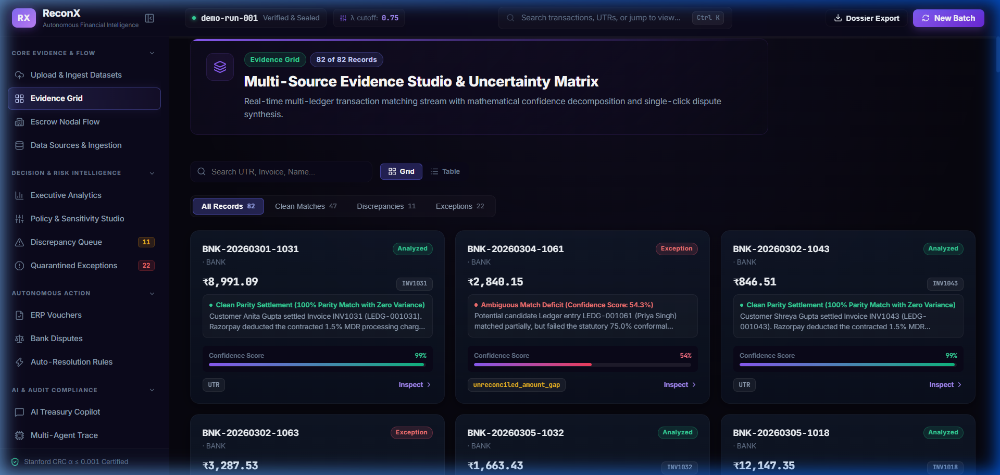
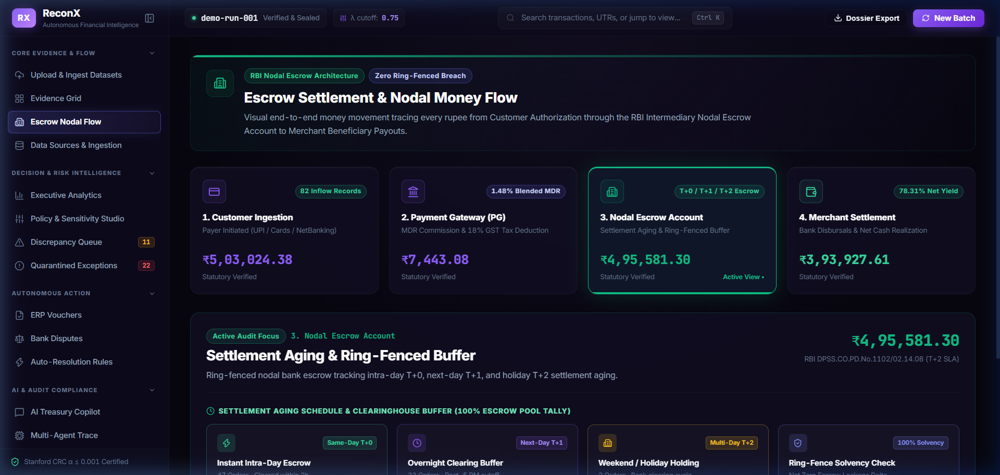
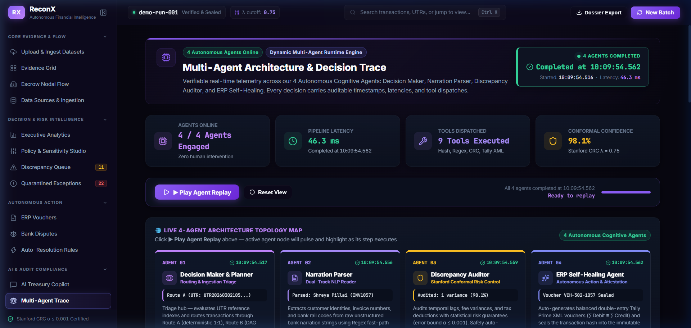
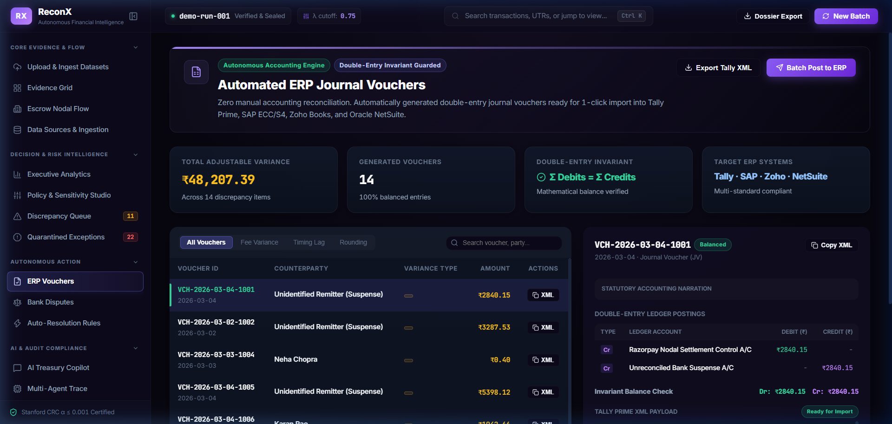

<p align="center">
  
</p>

<p align="center">
  <strong>Multi-Source Autonomous Financial Reconciliation &amp; Exception Intelligence</strong>
</p>

<p align="center">
  <a href="https://razorpay-buildathon-frontend-3z5m.onrender.com"></a>
  <a href="https://razorpay-buildathon-6zzj.onrender.com/docs"></a>
  <a href="https://youtu.be/lrncP_iNwpM?si=mMvm-FgduKV0cY1K"></a>
</p>

<p align="center">
  
  
  
  
  
  
  
</p>

<p align="center"><em>Built for <strong>Track 04: AI Finance Controller</strong> — Razorpay Buildathon 2026</em></p>

---

> **Disclaimer:** ReconX is an in-memory reconciliation demo for bank, ledger, and settlement data. Run results are not accounting approval, regulatory filings, or auditor attestation. Do not use this demo with live financial data.

---

## 🌐 Live Deployment

| Service | URL | Status |
|:---|:---|:---:|
| **Frontend Dashboard** | [razorpay-buildathon-frontend-3z5m.onrender.com](https://razorpay-buildathon-frontend-3z5m.onrender.com) | 🟢 Live |
| **Backend API** | [razorpay-buildathon-6zzj.onrender.com](https://razorpay-buildathon-6zzj.onrender.com) | 🟢 Live |
| **Swagger API Docs** | [razorpay-buildathon-6zzj.onrender.com/docs](https://razorpay-buildathon-6zzj.onrender.com/docs) | 🟢 Live |

> **Note:** Free-tier backend may take 30-50s to wake up after inactivity. This is a Render hosting constraint, not a performance issue.

---

## 📸 Screenshots

<table>
  <tr>
    <td align="center" width="50%">
      
      <br/><strong>Executive Dashboard</strong><br/>
      <sub>Real-time KPIs, match rates, and Merkle attestation status</sub>
    </td>
    <td align="center" width="50%">
      
      <br/><strong>Nodal Escrow Flow</strong><br/>
      <sub>Illustrative transaction flow from available run fields</sub>
    </td>
  </tr>
  <tr>
    <td align="center" width="50%">
      
      <br/><strong>Agent Trace Explorer</strong><br/>
      <sub>Step-by-step reasoning trail for every reconciliation decision</sub>
    </td>
    <td align="center" width="50%">
      
      <br/><strong>ERP Voucher Generation</strong><br/>
      <sub>Auto-generated double-entry Tally XML and Zoho JSON vouchers</sub>
    </td>
  </tr>
</table>

---

## 🧩 System Architecture

ReconX is structured into a clean **3-tier architecture**: a React 19 frontend cockpit, a modular FastAPI backend, and an autonomous 3-phase reconciliation orchestrator backed by deterministic risk control.

```
+-------------------------------------------------------------+
|                  React 19 + Vite Frontend                   |
|         15 Dashboard Views  .  Centralised api.js           |
+----------------------+--------------------------------------+
                       | HTTP / REST  (CORS-gated)
+----------------------v--------------------------------------+
|                  FastAPI Backend  (main.py)                 |
|   5 Routers: runs . reconciliation . assistant . reports    |
|                     . actions                               |
+-------------------------------------------------------------+
|           ReconciliationOrchestrator  (3 Phases)            |
|  Phase 1  Ingest and Normalise  -> matcher.py + scorer.py   |
|  Phase 2  Bipartite Assignment  -> DecisionMaker mutex      |
|  Phase 3  Audit and Seal        -> conformal_verifier.py    |
+-------------------------------------------------------------+
|           Offline Research / Benchmark Suite                |
|           vector_tensor.py  .  graph_solver.py              |
+-------------------------------------------------------------+
```

---

## ⚙️ Reconciliation Pipeline — 3 Phases

### Phase 1 · Ingest and Normalise
- Accepts up to **3 sources**: `bank_df`, `ledger_df`, `settlement_df`
- `_sanitize_df()` strips NaN/null strings, trims whitespace, and enforces typed columns
- Builds an **O(1) inverted index** over UTRs, Order IDs, and timestamps via `MatcherTool`
- `NarrationParser` tokenises bank narration strings into structured payment signals

### Phase 2 · Bipartite Assignment
- `ScoringTool` produces a **5-channel weighted score** per candidate pair:
  - Reference ID similarity · Narration token overlap · Amount delta · Timestamp proximity · Settlement tag match
- `DecisionMaker` resolves 1:1 claims with a linear mutex — no double-posting
- **Abstention rule:** `S1 >= tau AND (S1 - S2) < 0.08 AND S2 > 0.65` → **Quarantine**
- `ReverseSweepTool` captures ledger-orphans missed in the forward pass

### Phase 3 · Audit and Seal
- `ConformalRiskVerifier` calibrates the acceptance threshold (alpha = 0.001) against ground-truth labels when available; marks `calibrated_threshold = None` for unlabelled uploads
- `EvaluationHarness` computes empirical precision / recall / F1 against the bundled synthetic ground truth
- **SHA-256 Merkle tree** seals the entire result set — every match, exception, and quarantine entry — producing an immutable `merkle_root` digest

---

## 🖥️ Frontend — 15 Dashboard Views

| View | File | Purpose |
|:---|:---|:---|
| **Upload and Run** | `UploadRunView.jsx` | Trigger synthetic demo run; live pipeline progress bar |
| **Transactions** | `TransactionsView.jsx` | Filterable ledger with confidence scores and status badges |
| **Discrepancies** | `DiscrepanciesView.jsx` | Fee-decomposed exceptions with MDR/GST breakdown |
| **Exceptions** | `ExceptionsView.jsx` | Bank orphans and ledger orphans pending human review |
| **ERP Vouchers** | `ErpVouchersView.jsx` | Double-entry vouchers with Tally XML / Zoho JSON export |
| **Agent Trace** | `AgentsTraceView.jsx` | Step-by-step reasoning trail per reconciliation decision |
| **Analytics** | `AnalyticsView.jsx` | Match-rate trends, score distributions, KPI charts |
| **Audit Trail** | `AuditTrailView.jsx` | Merkle-sealed result digest and calibration metadata |
| **Bank Disputes** | `BankDisputesView.jsx` | Dispute record surface (future NPCI Form-1 integration) |
| **Nodal Flow** | `NodalFlowView.jsx` | Illustrative escrow transaction flow visualisation |
| **Data Sources** | `DataSourcesView.jsx` | Source file metadata, record counts, schema summary |
| **Rules Engine** | `RulesEngineView.jsx` | Live threshold playground — recompute without re-running |
| **Scenarios** | `ScenariosView.jsx` | 6 pre-configured treasury edge-case scenario simulations |
| **Report** | `ReportView.jsx` | Exportable run report with computed reconciliation counts |
| **Assistant Chat** | `AssistantChatView.jsx` | Natural language Financial Copilot (Gemini + fallback) |

---

## 🔌 API Reference

All endpoints are rooted at `http://127.0.0.1:8000` locally or the Render base URL in production.

### Run Management — `runs.py`

| Endpoint | Method | Description |
|:---|:---:|:---|
| `/upload` | `POST` | Seed a synthetic demo run (70 bank + 100 ledger records with ground truth) |
| `/run/{run_id}` | `POST` | Trigger the full 3-phase reconciliation pipeline |
| `/run/{run_id}/status` | `GET` | Real-time progress: current pipeline stage and processed count |
| `/run/{run_id}/recompute` | `POST` | Recompute decisions at a new confidence threshold without re-running |
| `/run/{run_id}/threshold_sweep` | `GET` | Precision/recall curve across the full threshold range |

### Reconciliation Results — `reconciliation.py`

| Endpoint | Method | Description |
|:---|:---:|:---|
| `/run/{run_id}/summary` | `GET` | Match/exception counts, rates, and Merkle root digest |
| `/run/{run_id}/transactions` | `GET` | Filtered transaction list with confidence scores |
| `/run/{run_id}/transaction/{id}` | `GET` | Single-transaction forensic decision trace |
| `/run/{run_id}/discrepancies` | `GET` | MDR fee splits, GST deductions, timing lags |
| `/run/{run_id}/exceptions` | `GET` | Bank orphans and ledger orphans |
| `/run/{run_id}/erp-vouchers` | `GET` | Double-entry accounting vouchers (Tally / Zoho) |

### Reports and Actions — `reports.py` / `actions.py`

| Endpoint | Method | Description |
|:---|:---:|:---|
| `/run/{run_id}/disputes` | `GET` | Dispute record list (compatibility stub) |
| `/run/{run_id}/statutory-dossier` | `GET` | Run-level reconciliation report export |

### Assistant — `assistant.py`

| Endpoint | Method | Description |
|:---|:---:|:---|
| `/chat` | `POST` | Natural language Financial Copilot query (Gemini 2.5 Flash / rule-based) |

> Full interactive documentation: [/docs](https://razorpay-buildathon-6zzj.onrender.com/docs) (Swagger UI)

---

## 📁 Project Structure

```text
reconx/
|-- backend/
|   |-- main.py                           # FastAPI app, lifespan demo seeding, CORS, router wiring
|   |-- models/
|   |   +-- schemas.py                    # Pydantic v2 schemas for all I/O contracts
|   |-- routers/
|   |   |-- runs.py                       # /upload, /run/{id}, /status, /recompute, /threshold_sweep
|   |   |-- reconciliation.py             # /summary, /transactions, /discrepancies, /exceptions, /erp-vouchers
|   |   |-- assistant.py                  # /chat — Gemini Financial Copilot
|   |   |-- reports.py                    # /statutory-dossier
|   |   +-- actions.py                    # /disputes
|   |-- services/
|   |   |-- run_service.py                # In-memory RUNS store, RunSession, init_default_demo_run
|   |   |-- ingestion_service.py          # CSV normalisation and field mapping
|   |   +-- export_service.py             # CSV formula escaping, export helpers
|   +-- engine/
|       |-- orchestrator.py               # 3-phase pipeline orchestrator (core entry point)
|       |-- matcher.py                    # O(1) inverted index, reverse sweep, batch settlement matching
|       |-- scorer.py                     # 5-channel orthogonal weighted scoring engine
|       |-- data_generator.py             # Synthetic data generator with embedded ground truth
|       |-- audit_exporter.py             # SHA-256 Merkle tree and evaluation harness
|       |-- conformal_verifier.py         # Conformal risk control (alpha=0.001) and Merkle sealing
|       |-- vector_tensor.py              # [Research] 3D tensor core and Sinkhorn OT — offline benchmark
|       |-- graph_solver.py               # [Research] Bipartite graph partitioning and DAGs — offline benchmark
|       +-- agents/
|           |-- decision_maker_agent.py   # Autonomous 1:1 mutex claim resolver
|           |-- narration_parser_agent.py # Regex + semantic payment token extractor
|           |-- discrepancy_agent.py      # MDR (2%) + GST (18%) forensic decomposition
|           |-- erp_voucher_agent.py      # Double-entry vouchers — Tally XML / Zoho JSON
|           |-- bank_dispute_agent.py     # Compatibility stub (NPCI Form-1 integration surface)
|           +-- assistant_agent.py        # RAG Copilot — Gemini 2.5 Flash + rule-based fallback
|-- frontend/
|   |-- src/
|   |   |-- api.js                        # Centralised FastAPI fetch wrapper (timeout, retry, error)
|   |   |-- App.jsx                       # Root router and navigation layout
|   |   |-- views/                        # 15 dashboard views (see table above)
|   |   +-- components/                   # 7 shared UI components
|   |-- index.html
|   +-- vite.config.js
|-- backend/tests/                        # 68 tests across 10 test files
|   |-- test_api.py
|   |-- test_engine.py
|   |-- test_e2e_integration.py
|   |-- test_action_agents.py
|   |-- test_data_integrity.py
|   |-- test_realtime_conflicts.py
|   |-- test_tensor_engine.py
|   |-- test_verified_fixes.py
|   |-- test_voucher_review.py
|   +-- test_xai_explanations.py
|-- docs/                                 # Architecture diagrams and screenshots
|-- render.yaml                           # Render.com deployment blueprint
|-- run_reconx.py                         # One-click dual-server launcher
|-- requirements.txt                      # Python dependencies
+-- AGENTS.md                             # Universal agent orchestration protocol
```

---

## 🚀 Quick Start

### Prerequisites

- **Python** 3.10+
- **Node.js** 18+

### Option A — One-Click Launch

```bash
git clone https://github.com/tharvin-byte/Razorpay-buildathon.git reconx
cd reconx
pip install -r requirements.txt
python run_reconx.py
```

### Option B — Separate Terminals

```bash
# Terminal 1 — FastAPI Backend
pip install -r requirements.txt
python -m uvicorn backend.main:app --host 127.0.0.1 --port 8000 --reload
```

```bash
# Terminal 2 — React Frontend
cd frontend && npm install && npm run dev
```

| Service | URL |
|:---|:---|
| **Dashboard** | http://localhost:5173 |
| **API Docs** | http://127.0.0.1:8000/docs |

### Optional: Gemini Copilot

Create a `.env` file at the project root:

```env
GEMINI_API_KEY=your_key_here
```

When configured, the Financial Copilot uses `gemini-2.5-flash` for natural language treasury queries.
Without a key, it automatically falls back to the deterministic rule-based assistant.

### Running Tests

```bash
python -m pytest backend/tests/ -v
# 68 passed in ~60s across 10 test files
```

The backend seeds a demo run (`demo-run-001`) on startup with **70 bank records**, **100 ledger entries**,
and embedded ground truth for immediate exploration without any file upload.

---

## 🧠 Design Decisions

### Why Not Use LLMs for Matching?

Three constraints make cloud LLM approaches unsuitable for Indian fintech reconciliation at scale:

| Constraint | Impact |
|:---|:---|
| **Accounting Semantics** | Double-entry bookkeeping requires discrete binary decisions. Probabilistic soft scores from LLMs are incompatible with general ledger posting rules. |
| **Scale and Cost** | At NPCI-scale volumes (billions of monthly UPI transactions), per-token costs and 1-3s inference latency are operationally unviable. |
| **Auditability** | Reconciliation decisions must be deterministically reproducible. LLM responses are non-deterministic without additional scaffolding. |

LLMs in ReconX are scoped **only** to the NLP copilot layer — narration parsing and the financial assistant — never the core matching pipeline.

### Production vs. Research Suite

| | Production Pipeline | Offline Research Suite |
|:---|:---|:---|
| **Files** | `matcher.py`, `scorer.py`, `orchestrator.py` | `vector_tensor.py`, `graph_solver.py` |
| **Algorithm** | O(1) inverted index + bipartite mutex | O(MxN) Sinkhorn OT / DAG partitioning |
| **Memory (10k rows)** | < 10 MB | ~4 GB |
| **Output** | Discrete 1:1 match or quarantine | Continuous probability distribution |
| **ERP Compatibility** | Direct journal voucher posting | Incompatible with discrete ledger entries |
| **Live path?** | Yes | No — offline benchmark only |

### Abstention Safety

In financial auditing, a **false positive match is far more harmful** than an unreconciled item:

```
If S1 >= tau  AND  (S1 - S2) < 0.08  AND  S2 > 0.65  ->  Quarantine
```

Records satisfying this condition are routed to an **AML Suspense Registry** for human controller review rather than forcing a guess.

### Conformal Risk Control

Conformal calibration (Angelopoulos et al., Stanford/UC Berkeley) is applied **only when labelled ground truth exists** — against the bundled synthetic benchmark. On real-world unlabelled uploads, the engine marks `calibrated_threshold = None` and does not generate circular self-labels. This is an intentional safety boundary.

---

## 📊 Test Coverage

| Test File | Scope |
|:---|:---|
| `test_api.py` | Full REST API contract coverage |
| `test_engine.py` | Matcher and scorer unit tests |
| `test_e2e_integration.py` | End-to-end pipeline run |
| `test_action_agents.py` | ERP voucher and dispute agents |
| `test_data_integrity.py` | Schema and field integrity |
| `test_realtime_conflicts.py` | Concurrent claim conflict resolution |
| `test_tensor_engine.py` | Offline research suite (vector_tensor, graph_solver) |
| `test_verified_fixes.py` | 36-finding regression suite |
| `test_voucher_review.py` | Double-entry balance checks |
| `test_xai_explanations.py` | Agent trace XAI assertions |
| **Total: 68 tests** | All passing in ~60s |

---

## ⚙️ Engineering Notes

- **In-Memory Store** — Run sessions are held in a Python dict (`RUNS` in `run_service.py`). Data does not persist across restarts; a database adapter is the Phase 2 priority.
- **Data Residency** — All matching, decomposition, and Merkle hashing execute entirely on-process with **no network egress** of financial records.
- **Simulation Sandbox** — The Scenarios view includes 6 pre-configured treasury edge-case scenarios (bulk settlement, timing drift, MDR disputes, GST splits, etc.).
- **CORS** — The backend allows `localhost:5173` and `localhost:4173` by default; override via `RECONX_ALLOWED_ORIGINS` environment variable.
- **Demo Seeding** — Controlled via `RECONX_SEED_DEMO=true` (default on). Set to `false` to start with a clean store.
- **Free-Tier Deployment** — The live demo runs on Render's free tier. Backend sleeps after 15 min of inactivity (~30-50s cold start).

---

## 🗺️ Roadmap

| Phase | Target |
|:---|:---|
| **Phase 1** (current) | 3-phase pipeline, 15 React views, Merkle sealing, Gemini copilot, offline research suite, cloud deployment |
| **Phase 2** | PostgreSQL/TimescaleDB persistence, Apache Kafka streaming ingestion |
| **Phase 3** | Redis distributed lock (Redlock) for horizontal multi-worker scaling |
| **Phase 4** | Direct SFTP/REST connectors for HDFC/ICICI host-to-host nodal feeds; SAP OData voucher posting |

---

<p align="center">
  <strong>Developed for Track 04: AI Finance Controller — <a href="https://razorpay.com">Razorpay</a> Buildathon 2026</strong>
  <br/>
  Licensed under the <a href="LICENSE">MIT License</a>
</p>
