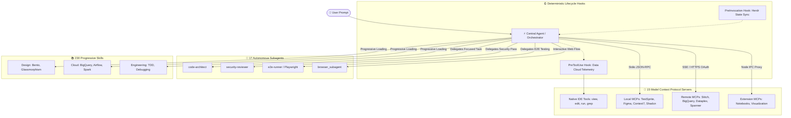
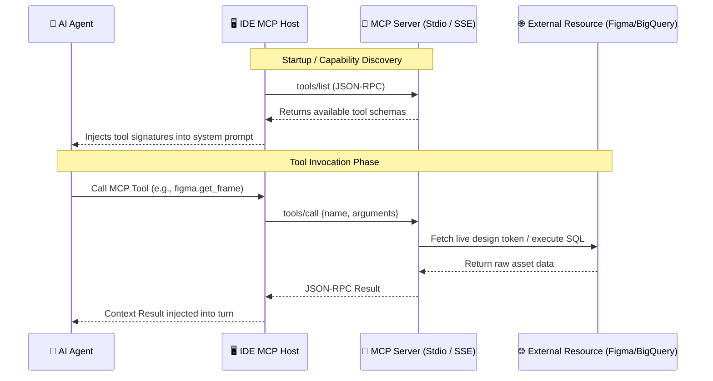
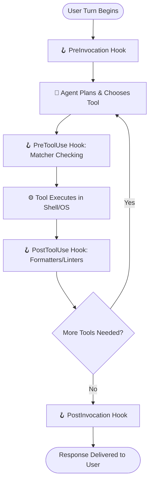

# 🌐 Enterprise System Capabilities & Architecture Guide

> **Antigravity IDE & Gemini CLI — Deep Architectural Reference**  
> An exhaustive, professional manual detailing the **Discovery Hierarchy**, **Storage Locations**, **Subagent Architecture**, **Progressive Skill Disclosure**, **Model Context Protocol (MCP) Connections**, and **Lifecycle Hooks**.

---

## 📑 Table of Contents
1. [Architectural Overview & Core Primitives](#1-architectural-overview--core-primitives)
2. [Storage Locations & Discovery Precedence](#2-storage-locations--discovery-precedence)
3. [Autonomous Subagents (17 Total)](#3-autonomous-subagents-17-total)
   - [System Architecture & Code Discovery](#system-architecture--code-discovery)
   - [Testing, Quality & Error Prevention](#testing-quality--error-prevention)
   - [Frontend, React & Modern Web](#frontend-react--modern-web)
   - [Security & Database Specialists](#security--database-specialists)
   - [Runtime Browser Automation](#runtime-browser-automation)
4. [Domain Skills (230 Total) & Progressive Disclosure](#4-domain-skills-230-total--progressive-disclosure)
   - [Core Software Engineering & Testing](#core-software-engineering--testing)
   - [UI Design Systems, Themes & Aesthetics](#ui-design-systems-themes--aesthetics)
   - [Frontend Frameworks, Next.js & Performance](#frontend-frameworks-nextjs--performance)
   - [Cloud Data, BigQuery & Pipeline Orchestration](#cloud-data-bigquery--pipeline-orchestration)
   - [Biomedical, Chemistry & Scientific Databases](#biomedical-chemistry--scientific-databases)
   - [Document Generators & Media Processors](#document-generators--media-processors)
   - [Specialized Integrations & Utilities](#specialized-integrations--utilities)
5. [Model Context Protocol (MCP) In-Depth (15 Servers)](#5-model-context-protocol-mcp-in-depth-15-servers)
   - [What is MCP?](#what-is-mcp)
   - [Transport Types: Stdio vs. SSE / Remote](#transport-types-stdio-vs-sse--remote)
   - [MCP Connection Mechanics & Data Flow](#mcp-connection-mechanics--data-flow)
   - [Full MCP Server Catalog & Configurations](#full-mcp-server-catalog--configurations)
6. [Lifecycle & Event Hooks (2 Suites)](#6-lifecycle--event-hooks-2-suites)
   - [Hook Lifecycle Execution Model](#hook-lifecycle-execution-model)
   - [Active Hook Suites Breakdown](#active-hook-suites-breakdown)
7. [Developer Playbook: Dispatching Capabilities](#7-developer-playbook-dispatching-capabilities)

---

## 1. Architectural Overview & Core Primitives

The Antigravity AI system does not rely on a monolithic prompt. Instead, it uses a modular, layered multi-agent architecture composed of four core primitives:



### Key Differences Between Primitives

| Dimension | Subagents | Skills | MCP Servers | Lifecycle Hooks |
|---|---|---|---|---|
| **What It Is** | An independent worker with its own prompt, tool permissions, and memory. | A markdown runbook containing instructions, templates, and patterns. | A JSON-RPC server exposing live external data and executable tools. | A deterministic shell script triggered at exact runtime points. |
| **Execution** | Runs in isolated turns; passes results back to caller. | Injected on-demand into the current agent's context window. | Called dynamically as a tool when the agent needs data or actions. | Runs outside the LLM; blocks or monitors execution deterministically. |
| **Protocol** | Agent-to-Agent protocol | Progressive Markdown injection | Model Context Protocol (MCP JSON-RPC 2.0) | Local Process / Exit code contracts |

---

## 2. Storage Locations & Discovery Precedence

Antigravity discovers customizations across three distinct hierarchical tiers. When names collide, higher-precedence roots override lower ones:

```
Tier 1: Workspace Root (Project-Specific)       [HIGHEST PRECEDENCE]
        e:\PROJECTS\razorpay\.agents\
        e:\PROJECTS\razorpay\skills\
                    ↓
Tier 2: Global Configuration (User Machine)    [INTERMEDIATE]
        C:\Users\THARVIN M\.gemini\config\agents\
        C:\Users\THARVIN M\.gemini\config\skills\
        C:\Users\THARVIN M\.gemini\config\plugins\
        C:\Users\THARVIN M\.gemini\config\mcp_config.json
        C:\Users\THARVIN M\.gemini\config\hooks.json
                    ↓
Tier 3: Builtin IDE Runtime (Bundled Defaults) [LOWEST PRECEDENCE]
        C:\Users\THARVIN M\.gemini\antigravity-ide\builtin\
```

### Exact Physical Storage Map

| Component | Physical Storage Location | File Format | Active Count |
|---|---|---|---|
| **Custom Subagents** | `C:\Users\THARVIN M\.gemini\config\agents\<agent-id>\` | `agent.md` (YAML frontmatter + Markdown) | **16** |
| **Built-in Subagent** | Built into IDE core runtime engine | Native Rust/Go/Node binary module | **1** (`browser_subagent`) |
| **Workspace Skills** | `e:\PROJECTS\razorpay\skills\<skill-id>\` | `SKILL.md` (YAML frontmatter + Markdown) | **147** |
| **Plugin / Global Skills** | `C:\Users\THARVIN M\.gemini\config\plugins\<plugin>\skills\` | `SKILL.md` | **80** |
| **Builtin Skills** | `C:\Users\THARVIN M\.gemini\antigravity-ide\builtin\skills\` | `SKILL.md` | **3** |
| **MCP Servers** | `C:\Users\THARVIN M\.gemini\config\mcp_config.json` | JSON Schema (`mcpServers` object) | **15** |
| **Lifecycle Hooks** | `C:\Users\THARVIN M\.gemini\config\hooks.json` | JSON Schema (Event-keyed arrays) | **2 Suites** |

---

## 3. Autonomous Subagents (17 Total)

### Anatomy of an `agent.md` File
Each subagent is defined by an `agent.md` file located in its named directory (e.g. `~/.gemini/config/agents/code-architect/agent.md`). The file contains:
1. **YAML Frontmatter**: Defines `name`, `description`, role flags (`subagent: true`), model inheritance, and the explicit subset of tools granted (`tools: [...]`).
2. **System Prompt Body**: Specifies persona, specialized domain rules, required output formats, and anti-patterns.

### System Architecture & Code Discovery

#### 🔹 `capability-orchestrator`
- **Path on Disk**: `C:\Users\THARVIN M\.gemini\config\agents\capability-orchestrator\agent.md`
- **Role**: Dynamically discovers, evaluates, composes, and dispatches the smallest effective combination of skills, plugins, MCP servers, tools, external connections, specialized sub-agents, and framework capabilities for each task. Resolves genuine capability conflicts, preserves complementary capabilities, minimizes context usage, and routes execution to the appropriate downstream agents.
- **Tools Granted**: `view_file, list_dir, grep_search`
- **Core Specializations**:
  * Skills (Global & Project-Local)
  * MCP servers
  * External connections

#### 🔹 `code-architect`
- **Path on Disk**: `C:\Users\THARVIN M\.gemini\config\agents\code-architect\agent.md`
- **Role**: Principal software architecture specialist for system design, scalable implementation planning, trade-off analysis, and anti-pattern prevention. Use when planning new features, refactoring systems, or evaluating architectural trade-offs before implementation.
- **Tools Granted**: `view_file, list_dir, grep_search`
- **Core Specializations**:
  * 🚩 **Big Ball of Mud**: State or business logic scattered across unrelated components without clear module boundaries.
  * 🚩 **God Object / God Component**: A single module, component, or class handling fetching, validation, state, rendering, and persistence.
  * 🚩 **Premature Optimization**: Introducing caching layers, background workers, microservices, or complex state machines before basic functionality is proven.

#### 🔹 `code-explorer`
- **Path on Disk**: `C:\Users\THARVIN M\.gemini\config\agents\code-explorer\agent.md`
- **Role**: Deeply analyzes an existing codebase by tracing execution paths, architecture layers, dependencies, integrations, patterns, and abstractions before development. Use before any implementation task to build shared context.
- **Tools Granted**: `view_file, list_dir, grep_search`
- **Core Specializations**:
  * Project directory structure and module boundaries
  * Entry points and execution paths
  * Data flow and transformations

#### 🔹 `code-simplifier`
- **Path on Disk**: `C:\Users\THARVIN M\.gemini\config\agents\code-simplifier\agent.md`
- **Role**: Simplifies and refines code for clarity, consistency, and maintainability while strictly preserving behavior. Use after implementing features to eliminate dead code, unused imports, over-abstracted single-use helpers, and complex conditionals.
- **Tools Granted**: `view_file, list_dir, grep_search, replace_file_content, write_to_file`
- **Core Specializations**:
  * Unwind Over-Abstracted Helpers**: Invert unnecessary single-use helper functions or wrappers that only add indirection.
  * Early Returns / Guard Clauses**: Replace deeply nested `if/else` ladders with early returns.
  * Async/Await**: Replace tangled `.then()/.catch()` callback chains with idiomatic `async/await`.

### Testing, Quality & Error Prevention

#### 🔹 `code-reviewer`
- **Path on Disk**: `C:\Users\THARVIN M\.gemini\config\agents\code-reviewer\agent.md`
- **Role**: Reviews implementation changes for correctness, bugs, security vulnerabilities, regressions, maintainability, project conventions, and integration problems before code is considered complete.
- **Tools Granted**: `view_file, list_dir, grep_search`
- **Core Specializations**:
  * Logic errors and edge cases
  * Broken execution paths and unhandled error states
  * Missing input validation

#### 🔹 `silent-failure-hunter`
- **Path on Disk**: `C:\Users\THARVIN M\.gemini\config\agents\silent-failure-hunter\agent.md`
- **Role**: Hunts silent failures, swallowed errors, bad fallbacks, and missing error propagation in code. Use PROACTIVELY after writing error handling, async code, API integrations, or database operations. Specialized pass that typescript-reviewer and react-reviewer do NOT fully cover — finds code that appears to work but silently loses errors.
- **Tools Granted**: `view_file, list_dir, grep_search`
- **Core Specializations**:
  * Intentional fallbacks with clear documentation and downstream handling
  * Error boundaries in React (intentional catch-and-render pattern)
  * `catch` blocks that re-throw with added context

#### 🔹 `tdd-guide`
- **Path on Disk**: `C:\Users\THARVIN M\.gemini\config\agents\tdd-guide\agent.md`
- **Role**: Test-Driven Development specialist enforcing write-tests-first methodology. Use PROACTIVELY when writing new features, fixing bugs, or refactoring code. Ensures 80%+ test coverage via Red-Green-Refactor cycle. Does NOT overlap with react-reviewer or typescript-reviewer — those review existing code, this guides writing tests before implementation.
- **Tools Granted**: `view_file, list_dir, grep_search, run_command, replace_file_content, write_to_file`
- **Core Specializations**:
  * Enforce tests-before-code methodology
  * Guide through Red-Green-Refactor cycle
  * Ensure 80%+ test coverage

#### 🔹 `e2e-runner`
- **Path on Disk**: `C:\Users\THARVIN M\.gemini\config\agents\e2e-runner\agent.md`
- **Role**: End-to-end testing specialist using browser automation with Playwright. Use PROACTIVELY for generating, maintaining, and running E2E tests on critical user flows. Manages test journeys, quarantines flaky tests, captures screenshots and videos, and ensures critical user flows work end-to-end. Does NOT overlap with tdd-guide (unit/integration) — this is browser-level flow testing only.
- **Tools Granted**: `view_file, list_dir, grep_search, run_command, replace_file_content, write_to_file`
- **Core Specializations**:
  * Identify critical user journeys (auth, core features, payments, CRUD)
  * Define scenarios: happy path, edge cases, error cases
  * Prioritize by risk: HIGH (financial, auth), MEDIUM (search, nav), LOW (UI polish)

### Frontend, React & Modern Web

#### 🔹 `react-reviewer`
- **Path on Disk**: `C:\Users\THARVIN M\.gemini\config\agents\react-reviewer\agent.md`
- **Role**: Expert React/JSX code reviewer specializing in hook correctness, render performance, server/client component boundaries, accessibility, and React-specific security. Use for any change touching .tsx/.jsx files or React component logic. MUST BE USED for React projects. Invoke alongside typescript-reviewer on all .tsx/.jsx PRs.
- **Tools Granted**: `view_file, list_dir, grep_search, run_command`
- **Core Specializations**:
  * PR review: use the actual base branch via `gh pr view --json baseRefName` when available; otherwise the current branch's upstream/merge-base. Never hard-code `main`.
  * Local review: prefer `git diff --staged -- '*.tsx' '*.jsx'` then `git diff -- '*.tsx' '*.jsx'`.
  * If history is shallow or single-commit, fall back to `git show --patch HEAD -- '*.tsx' '*.jsx'`.

#### 🔹 `react-build-resolver`
- **Path on Disk**: `C:\Users\THARVIN M\.gemini\config\agents\react-build-resolver\agent.md`
- **Role**: Diagnose and fix React build failures across Vite, webpack, Next.js, CRA, Parcel, esbuild, and Bun. Handles JSX/TSX compile errors, hydration mismatches, server/client component boundary failures, missing types, and bundler-specific configuration issues with minimal, surgical changes. MUST BE USED when a React build fails.
- **Tools Granted**: `view_file, list_dir, grep_search, run_command, replace_file_content, write_to_file`
- **Core Specializations**:
  * Surgical fixes only** — don't refactor, just fix the error
  * Never** disable type-checking or lint rules to "make it green"
  * Never** add `// @ts-ignore` without an inline explanation and a TODO

#### 🔹 `typescript-reviewer`
- **Path on Disk**: `C:\Users\THARVIN M\.gemini\config\agents\typescript-reviewer\agent.md`
- **Role**: Expert TypeScript/JavaScript code reviewer specializing in type safety, async correctness, Node/web security, and idiomatic patterns. Use for all TypeScript and JavaScript code changes. MUST BE USED for TypeScript/JavaScript projects. For .tsx/.jsx files invoke alongside react-reviewer.
- **Tools Granted**: `view_file, list_dir, grep_search, run_command`
- **Core Specializations**:
  * For PR review, use the actual PR base branch when available (e.g., `gh pr view --json baseRefName`) or the current branch's upstream/merge-base. Do not hard-code `main`.
  * For local review, prefer `git diff --staged` and `git diff` first.
  * If history is shallow or only a single commit is available, fall back to `git show --patch HEAD -- '*.ts' '*.tsx' '*.js' '*.jsx'`.

#### 🔹 `performance-optimizer`
- **Path on Disk**: `C:\Users\THARVIN M\.gemini\config\agents\performance-optimizer\agent.md`
- **Role**: Performance analysis and optimization specialist. Use PROACTIVELY for identifying bottlenecks, optimizing slow code, reducing bundle sizes, and improving runtime performance. Handles profiling, memory leaks, React render optimization, code splitting, and algorithmic improvements.
- **Tools Granted**: `view_file, list_dir, grep_search, run_command, replace_file_content, write_to_file`
- **Core Specializations**:
  * `React.memo`: Only wrap components that receive stable props and are expensive to render
  * `useMemo`: Only for computationally expensive derivations (sort, filter large arrays, regex)
  * `useCallback`: Only when the function is passed to a memoized child or used in a dep array

#### 🔹 `a11y-architect`
- **Path on Disk**: `C:\Users\THARVIN M\.gemini\config\agents\a11y-architect\agent.md`
- **Role**: Accessibility Architect specializing in WCAG 2.2 compliance for Web and Native platforms. Use PROACTIVELY when designing UI components, establishing design systems, or auditing code for inclusive user experiences. Provides ARIA specs, focus flow, keyboard nav, and touch target requirements.
- **Tools Granted**: `view_file, list_dir, grep_search, replace_file_content, write_to_file`
- **Core Specializations**:
  * Architecting Inclusivity**: Design UI systems that natively support assistive technologies (Screen Readers, Voice Control, Switch Access).
  * WCAG 2.2 Enforcement**: Apply the latest success criteria, focusing on new standards like Focus Appearance, Target Size, and Redundant Entry.
  * Platform Strategy**: Bridge the gap between Web standards (WAI-ARIA) and Native frameworks (SwiftUI/Jetpack Compose).

#### 🔹 `seo-specialist`
- **Path on Disk**: `C:\Users\THARVIN M\.gemini\config\agents\seo-specialist\agent.md`
- **Role**: SEO specialist for technical SEO audits, on-page optimization, structured data, Core Web Vitals, and content/keyword mapping. Use for site audits, meta tag reviews, schema markup, sitemap and robots issues, and SEO remediation plans.
- **Tools Granted**: `view_file, list_dir, grep_search, run_command, read_url_content, search_web`
- **Core Specializations**:
  * Crawl or index blockers on important pages
  * `robots.txt` or meta-robots conflicts
  * Canonical loops or broken canonical targets

### Security & Database Specialists

#### 🔹 `security-reviewer`
- **Path on Disk**: `C:\Users\THARVIN M\.gemini\config\agents\security-reviewer\agent.md`
- **Role**: Security vulnerability detection and remediation specialist. Use PROACTIVELY after writing code that handles user input, authentication, API endpoints, file uploads, payments, or sensitive data. Flags hardcoded secrets, SSRF, injection, broken auth, unsafe crypto, and OWASP Top 10 vulnerabilities. Does NOT overlap with react-reviewer or typescript-reviewer — this is a dedicated security-only pass.
- **Tools Granted**: `view_file, list_dir, grep_search, run_command`
- **Core Specializations**:
  * Environment variables in `.env.example` (not actual secrets)
  * Test credentials in test files (if clearly marked)
  * Public API keys (if actually meant to be public)

#### 🔹 `database-reviewer`
- **Path on Disk**: `C:\Users\THARVIN M\.gemini\config\agents\database-reviewer\agent.md`
- **Role**: Relational database & SQL specialist for PostgreSQL, Supabase, Prisma, and ORM schemas. Reviews query performance, schema design, foreign key indexing, migrations, connection pooling, and detects N+1 queries.
- **Tools Granted**: `view_file, list_dir, grep_search, run_command`
- **Core Specializations**:
  * Foreign Key Indexing**: Are all foreign key columns indexed? (Unindexed FKs cause full table scans during joins and cascade deletes).
  * Index Composite Order**: Ensure composite indexes follow equality columns first, then range/sort columns.
  * N+1 Query Detection**: Flag database calls inside loops, array `.map()` iterations, or uncached nested resolvers.

### Runtime Browser Automation
#### 🔹 `browser_subagent`
- **Path on Disk**: Built-in native IDE runtime tool
- **Role**: Autonomous interactive browser agent with dedicated tools to launch headless or headed browser sessions, navigate URLs, click interactive elements, type input, inspect live DOM state, resize viewports, and automatically record sessions as WebP animations in the artifact store.
- **Tools Granted**: `open_browser_url`, `click_element`, `type_text`, `read_dom`, `capture_screenshot`, `resize_viewport`
- **Core Specializations**:
  * Live UI end-to-end verification and regression testing.
  * Automated WebP interaction recording for audit proof.
  * Real-time DOM inspection and interactive workflow execution.

---

## 4. Domain Skills (230 Total) & Progressive Disclosure

### How Skills Work (The Progressive Disclosure Model)
Loading 230 full skill documents simultaneously would consume hundreds of thousands of tokens and degrade LLM attention. Antigravity solves this with **Progressive Disclosure**:
1. **Tier 1 (Catalog Injection)**: At startup, only the skill `name` and one-line `description` are loaded into system memory (~2% context footprint).
2. **Tier 2 (Intent Matching)**: When the user requests a task (e.g. *"Build a BigQuery pipeline"* or *"Style this in Neobrutalism"*), the orchestrator scans descriptions.
3. **Tier 3 (On-Demand Hydration)**: The agent invokes `view_file` on the target `SKILL.md` to load the complete runbook, templates, and reference scripts only for the duration of that task.

### Core Software Engineering & Testing (21 Skills)

| Skill Name | Source Location | Description / Trigger Condition |
|---|---|---|
| **`accidental-data-loss-prevention`** | Workspace (`e:\PROJECTS\razorpay\skills\`) | **STOP AND VERIFY**: Before running any command or tool that results in irreversible data loss, you MUST obtain explicit user consent. When in doubt, ask. It... |
| **`author-auth0-skill`** | Workspace (`e:\PROJECTS\razorpay\skills\`) | Use when adding or editing Auth0 guidance in this repo's single auth0 skill — a new framework, feature, tooling, or pattern reference — to get the file struc... |
| **`executing-plans`** | Workspace (`e:\PROJECTS\razorpay\skills\`) | Use when you have a written implementation plan to execute in a separate session with review checkpoints |
| **`finishing-a-development-branch`** | Workspace (`e:\PROJECTS\razorpay\skills\`) | Use when implementation is complete, all tests pass, and you need to decide how to integrate the work |
| **`full-output-enforcement`** | Workspace (`e:\PROJECTS\razorpay\skills\`) | Overrides default LLM truncation behavior. Enforces complete code generation, bans placeholder patterns, and handles token-limit splits cleanly. Apply to any... |
| **`gcp-managed-airflow-dag-authoring`** | Workspace (`e:\PROJECTS\razorpay\skills\`) | Guides the authoring and validation of Apache Airflow DAGs for Managed Service for Apache Airflow (MSAA; formerly Cloud Composer). Covers environment context... |
| **`managing-python-dependencies`** | Workspace (`e:\PROJECTS\razorpay\skills\`) | Ensures proper Python dependency management, avoiding global `pip install` and adhering to project-specific tooling.  Use this skill if any of the following ... |
| **`permissioned-github`** | Builtin (`~\.gemini\antigravity-ide\builtin\`) | Guidelines for interacting with GitHub and request permissions from the user when commands fail due to restrictions in the agent environment. |
| **`receiving-code-review`** | Workspace (`e:\PROJECTS\razorpay\skills\`) | Use when receiving code review feedback, before implementing suggestions, especially if feedback seems unclear or technically questionable - requires technic... |
| **`requesting-code-review`** | Workspace (`e:\PROJECTS\razorpay\skills\`) | Use when completing tasks, implementing major features, or before merging to verify work meets requirements |
| **`scienceskillscommon`** | Config / Plugin (`~\.gemini\config\`) | Shared Python package for Science Skills, currently containing http_client -- a unified HTTP client with rate limiting, retries, and exponential backoff. Not... |
| **`skill-creator`** | Workspace (`e:\PROJECTS\razorpay\skills\`) | Create new skills, modify and improve existing skills, and measure skill performance. Use when users want to create a skill from scratch, edit, or optimize a... |
| **`skill-repair`** | Workspace (`e:\PROJECTS\razorpay\skills\`) | Use this to fix and re-install agent skills that have failed installation. This skill provides the necessary context and permissions to surgically update the... |
| **`systematic-debugging`** | Workspace (`e:\PROJECTS\razorpay\skills\`) | Use when encountering any bug, test failure, or unexpected behavior, before proposing fixes |
| **`test-driven-development`** | Workspace (`e:\PROJECTS\razorpay\skills\`) | Use when implementing any feature or bugfix, before writing implementation code |
| **`using-git-worktrees`** | Workspace (`e:\PROJECTS\razorpay\skills\`) | Use when starting feature work that needs isolation from current workspace or before executing implementation plans - ensures an isolated workspace exists vi... |
| **`using-superpowers`** | Workspace (`e:\PROJECTS\razorpay\skills\`) | Use when starting any conversation - establishes how to find and use skills, requiring skill invocation before ANY response including clarifying questions |
| **`webapp-testing`** | Workspace (`e:\PROJECTS\razorpay\skills\`) | Toolkit for interacting with and testing local web applications using Playwright. Supports verifying frontend functionality, debugging UI behavior, capturing... |
| **`workflow-skill-creator`** | Config / Plugin (`~\.gemini\config\`) | Distills a completed user workflow or interaction into a reusable agent skill. Use when the user asks to turn their workflow, interaction, or multi-step proc... |
| **`writing-plans`** | Workspace (`e:\PROJECTS\razorpay\skills\`) | Use when you have a spec or requirements for a multi-step task, before touching code |
| **`writing-skills`** | Workspace (`e:\PROJECTS\razorpay\skills\`) | Use when creating new skills, editing existing skills, or verifying skills work before deployment |

### UI Design Systems, Themes & Aesthetics (48 Skills)

| Skill Name | Source Location | Description / Trigger Condition |
|---|---|---|
| **`algorithmic-art`** | Workspace (`e:\PROJECTS\razorpay\skills\`) | Creating algorithmic art using p5.js with seeded randomness and interactive parameter exploration. Use this when users request creating art using code, gener... |
| **`artistic`** | Workspace (`e:\PROJECTS\razorpay\skills\`) | High-contrast, expressive style with creative typography and bold color choices for visually striking interfaces. |
| **`bento`** | Workspace (`e:\PROJECTS\razorpay\skills\`) | Modular grid layout with card-like blocks, clear hierarchy, soft spacing, and subtle visual contrast for organized, scannable interfaces. |
| **`bold`** | Workspace (`e:\PROJECTS\razorpay\skills\`) | Strong visual presence with heavyweight typography, high-contrast colors, and commanding layouts. |
| **`brandkit`** | Workspace (`e:\PROJECTS\razorpay\skills\`) | Premium brand-kit image generation skill for creating high-end brand-guidelines boards, logo systems, identity decks, and visual-world presentations. Trained... |
| **`brutalism`** | Workspace (`e:\PROJECTS\razorpay\skills\`) | Raw, anti-design aesthetic inspired by concrete architecture with unadorned elements, jarring layouts, and functional minimalism. |
| **`cafe`** | Workspace (`e:\PROJECTS\razorpay\skills\`) | Cozy cafe-inspired interface with warm tones, soft typography, and clean layouts for a relaxed browsing experience. |
| **`canvas-design`** | Workspace (`e:\PROJECTS\razorpay\skills\`) | Create beautiful visual art in .png and .pdf documents using design philosophy. You should use this skill when the user asks to create a poster, piece of art... |
| **`claymorphism`** | Workspace (`e:\PROJECTS\razorpay\skills\`) | Soft, rounded 3D-like shapes mimicking malleable clay with playful, puffy elements and colorful surfaces. |
| **`clean`** | Workspace (`e:\PROJECTS\razorpay\skills\`) | Simplicity-focused design with ample whitespace, legible typography, and a limited color palette to reduce visual clutter. |
| **`colorful`** | Workspace (`e:\PROJECTS\razorpay\skills\`) | Vibrant, high-contrast palettes and gradients for engaging, memorable, and modern user experiences. |
| **`corporate`** | Workspace (`e:\PROJECTS\razorpay\skills\`) | Professional, brand-aligned design with structured grids, minimalist layouts, and consistent enterprise patterns. |
| **`data-autocleaning`** | Workspace (`e:\PROJECTS\razorpay\skills\`) | Automated data quality and transformation capabilities for Dataform/dbt/BigQuery pipelines. Processes data sourced from BigQuery or Cloud Storage (GCS), appl... |
| **`design-taste-frontend`** | Workspace (`e:\PROJECTS\razorpay\skills\`) | Anti-slop frontend skill for landing pages, portfolios, and redesigns. The agent reads the brief, infers the right design direction, and ships interfaces tha... |
| **`doodle`** | Workspace (`e:\PROJECTS\razorpay\skills\`) | Hand-drawn, sketch-like style with doodles, handwritten fonts, and imperfect lines for a playful, informal feel. |
| **`editorial`** | Workspace (`e:\PROJECTS\razorpay\skills\`) | Magazine-inspired editorial layout with refined serif typography, structured grids, and elegant reading experiences. |
| **`figma-design-to-code`** | Workspace (`e:\PROJECTS\razorpay\skills\`) | **MANDATORY prerequisite** — you MUST invoke this skill BEFORE calling the `get_design_context` Figma MCP tool. You MUST trigger this skill whenever the user... |
| **`frontend-design`** | Workspace (`e:\PROJECTS\razorpay\skills\`) | Guidance for distinctive, intentional visual design when building new UI or reshaping an existing one. Helps with aesthetic direction, typography, and making... |
| **`glassmorphism`** | Workspace (`e:\PROJECTS\razorpay\skills\`) | Frosted glass effect with translucent layers, subtle blur, and luminous borders for depth and modern elegance. |
| **`gradient`** | Workspace (`e:\PROJECTS\razorpay\skills\`) | Smooth color transitions and gradient-rich surfaces for modern, playful interfaces with visual depth. |
| **`high-end-visual-design`** | Workspace (`e:\PROJECTS\razorpay\skills\`) | Teaches the AI to design like a high-end agency. Defines the exact fonts, spacing, shadows, card structures, and animations that make a website feel expensiv... |
| **`industrial-brutalist-ui`** | Workspace (`e:\PROJECTS\razorpay\skills\`) | Raw mechanical interfaces fusing Swiss typographic print with military terminal aesthetics. Rigid grids, extreme type scale contrast, utilitarian color, anal... |
| **`matrix`** | Workspace (`e:\PROJECTS\razorpay\skills\`) | A cyber-slick, dark-only Matrix-inspired interface defined by minimalist fashion, high-tech digital elements |
| **`minimal`** | Workspace (`e:\PROJECTS\razorpay\skills\`) | Stripped-back design emphasizing whitespace, clean typography, and restrained color for maximum clarity and focus. |
| **`minimalist-ui`** | Workspace (`e:\PROJECTS\razorpay\skills\`) | Clean editorial-style interfaces. Warm monochrome palette, typographic contrast, flat bento grids, muted pastels. No gradients, no heavy shadows. |
| **`modern`** | Workspace (`e:\PROJECTS\razorpay\skills\`) | Contemporary editorial style with serif typography, minimal palettes, and clean layouts for polished digital products. |
| **`mono`** | Workspace (`e:\PROJECTS\razorpay\skills\`) | Monospace-driven, matrix-inspired design with high-contrast elements, compact density, and a hacker-chic aesthetic. |
| **`neobrutalism`** | Workspace (`e:\PROJECTS\razorpay\skills\`) | Modern take on brutalism with bold borders, vivid accent colors, and raw, high-contrast layouts on warm surfaces. |
| **`neon`** | Workspace (`e:\PROJECTS\razorpay\skills\`) | Electric neon glow effects with high-contrast color pairings for bold, attention-grabbing interfaces. |
| **`neumorphism`** | Workspace (`e:\PROJECTS\razorpay\skills\`) | Soft, extruded UI elements with inner and outer shadows on monochromatic surfaces for a tactile, embedded look. |
| **`next-partial-prefetching-adoption`** | Workspace (`e:\PROJECTS\razorpay\skills\`) | Turn on Partial Prefetching in a Next.js app and work through the insights it surfaces. Use when the user wants to enable or adopt Partial Prefetching, flip ... |
| **`pacman`** | Workspace (`e:\PROJECTS\razorpay\skills\`) | Retro arcade-inspired design with pixel fonts, dotted borders, playful high-contrast colors, and 8-bit game aesthetics. |
| **`pulse`** | Workspace (`e:\PROJECTS\razorpay\skills\`) | Dynamic, vibrant style with thick borders, geometric shapes, high-contrast colors, and expressive typography conveying motion and vitality. |
| **`redesign-existing-projects`** | Workspace (`e:\PROJECTS\razorpay\skills\`) | Upgrades existing websites and apps to premium quality. Audits current design, identifies generic AI patterns, and applies high-end design standards without ... |
| **`retro`** | Workspace (`e:\PROJECTS\razorpay\skills\`) | Throwback design with vintage-inspired typography, high-contrast retro palettes, and nostalgic visual elements. |
| **`riso`** | Workspace (`e:\PROJECTS\razorpay\skills\`) | A playful, joyful, two-color risograph print aesthetic built on a single warm off-white paper surface running through every section |
| **`sega`** | Workspace (`e:\PROJECTS\razorpay\skills\`) | A playful, arcade-inspired interface for games — built on the VT323 pixel typeface, hard-edged 0px corners, chunky pill buttons that physically press into so... |
| **`shadcn`** | Workspace (`e:\PROJECTS\razorpay\skills\`) | Manages shadcn components and projects — adding, searching, fixing, debugging, styling, and composing UI, including chat interfaces. Provides project context... |
| **`sketch`** | Workspace (`e:\PROJECTS\razorpay\skills\`) | A friendly, hand-drawn sketch interface inspired by pencil illustrations on warm cream paper. Soft teal brand accents, hand-written display headings, rounded... |
| **`skeumorphism`** | Workspace (`e:\PROJECTS\razorpay\skills\`) | Real-world mimicry with textured surfaces, 3D effects, and familiar physical metaphors for intuitive digital interfaces. |
| **`sleek`** | Workspace (`e:\PROJECTS\razorpay\skills\`) | Modern minimalist aesthetic with clean lines, intentional color palette, subtle interactions, and consistent spacing. |
| **`stitch`** | Workspace (`e:\PROJECTS\razorpay\skills\`) | Clean, high-contrast enterprise design for data-driven workflows with intuitive drag-and-drop patterns and structured layouts. |
| **`terracotta`** | Workspace (`e:\PROJECTS\razorpay\skills\`) | A sun-baked, clay-toned editorial interface built on warm cream surfaces, ink-brown headlines set in a display serif, and a single terracotta accent. |
| **`tetris`** | Workspace (`e:\PROJECTS\razorpay\skills\`) | Classic block-game inspired design with playful colors, bold display fonts, and compact, high-energy layouts. |
| **`theme-factory`** | Workspace (`e:\PROJECTS\razorpay\skills\`) | Toolkit for styling artifacts with a theme. These artifacts can be slides, docs, reportings, HTML landing pages, etc. There are 10 pre-set themes with colors... |
| **`vintage`** | Workspace (`e:\PROJECTS\razorpay\skills\`) | 1950s-1990s nostalgia with skeuomorphic touches, grainy textures, retro color palettes, and pixel-style typography. |
| **`web-artifacts-builder`** | Workspace (`e:\PROJECTS\razorpay\skills\`) | Suite of tools for creating elaborate, multi-component claude.ai HTML artifacts using modern frontend web technologies (React, Tailwind CSS, shadcn/ui). Use ... |
| **`web-design-guidelines`** | Workspace (`e:\PROJECTS\razorpay\skills\`) | Review UI code for Web Interface Guidelines compliance. Use when asked to "review my UI", "check accessibility", "audit design", "review UX", or "check my si... |

### Frontend Frameworks, Next.js & Performance (13 Skills)

| Skill Name | Source Location | Description / Trigger Condition |
|---|---|---|
| **`frontend-app-builder`** | Workspace (`e:\PROJECTS\razorpay\skills\`) | Use for new frontend applications, dashboards, games, creative websites, hero sections, and visually driven UI from scratch, or when the user explicitly asks... |
| **`image-to-code`** | Workspace (`e:\PROJECTS\razorpay\skills\`) | Elite website image-to-code skill for Codex. For visually important web tasks, it must first generate the design image(s) itself, deeply analyze them, then i... |
| **`imagegen-frontend-mobile`** | Workspace (`e:\PROJECTS\razorpay\skills\`) | Elite mobile app image-generation skill for creating premium, app-native screen concepts and flows. Designed for iOS, Android, and cross-platform mobile prod... |
| **`imagegen-frontend-web`** | Workspace (`e:\PROJECTS\razorpay\skills\`) | Elite frontend image-direction skill for generating premium, conversion-aware website design references. CRITICAL OUTPUT RULE — generate ONE separate horizon... |
| **`next-cache-components-adoption`** | Workspace (`e:\PROJECTS\razorpay\skills\`) | Turn on Cache Components in a Next.js app and resolve the blocking routes it surfaces. Use when the user wants to enable, adopt, or migrate to Cache Componen... |
| **`next-cache-components-optimizer`** | Workspace (`e:\PROJECTS\razorpay\skills\`) | Drive a Next.js route to instant navigation by setting up an agentic loop, under Cache Components / PPR, on initial load (hard navigation) and client-side na... |
| **`next-dev-loop`** | Workspace (`e:\PROJECTS\razorpay\skills\`) | Verify Next.js runtime behavior after editing app code. Use this skill to confirm a change actually works in a running app — not just that it compiles or typ... |
| **`nextjs-framer-motion-animations`** | Workspace (`e:\PROJECTS\razorpay\skills\`) | Adds production-safe Motion for React or Framer Motion animations to Next.js apps, including reveal, hover and tap micro-interactions, whileInView, stagger, ... |
| **`reactome-database`** | Config / Plugin (`~\.gemini\config\`) | Query the Reactome database (Analysis and Content Services). Use when the user asks about pathway analysis, gene list enrichment, retrieving results by token... |
| **`vercel-composition-patterns`** | Workspace (`e:\PROJECTS\razorpay\skills\`) | React composition patterns that scale. Use when refactoring components with boolean prop proliferation, building flexible component libraries, or designing r... |
| **`vercel-optimize`** | Workspace (`e:\PROJECTS\razorpay\skills\`) | Use for Vercel cost and performance optimization on deployed projects, especially Next.js, SvelteKit, Nuxt, and limited Astro apps. Collect Vercel metrics, u... |
| **`vercel-react-best-practices`** | Workspace (`e:\PROJECTS\razorpay\skills\`) | React and Next.js performance optimization guidelines from Vercel Engineering. This skill should be used when writing, reviewing, or refactoring React/Next.j... |
| **`vercel-react-view-transitions`** | Workspace (`e:\PROJECTS\razorpay\skills\`) | Guide for implementing smooth, native-feeling animations using React's View Transition API (`<ViewTransition>` component, `addTransitionType`, and CSS view t... |

### Cloud Data, BigQuery & Pipeline Orchestration (22 Skills)

| Skill Name | Source Location | Description / Trigger Condition |
|---|---|---|
| **`bigquery-ai-ml`** | Workspace (`e:\PROJECTS\razorpay\skills\`) | Leverages BigQuery's built-in machine learning and GenAI capabilities for advanced data analytics. Use when you need to write SQL queries that perform time-s... |
| **`bigquery-bigframes`** | Workspace (`e:\PROJECTS\razorpay\skills\`) | Generates Python code using BigQuery DataFrames (BigFrames), the pandas/scikit-learn-style API over BigQuery. Use when writing BigFrames code or doing pandas... |
| **`bigquery-data-transfer-service`** | Workspace (`e:\PROJECTS\razorpay\skills\`) | Discovers and inspects BigQuery Data Transfer Service (DTS) configurations. Use this to identify existing ingestion pipelines and extract datasource or trans... |
| **`bigquery-graph`** | Workspace (`e:\PROJECTS\razorpay\skills\`) | Provides guidelines and best practices for querying and defining property graphs and semantic graphs in BigQuery using GQL (Graph Query Language). Use when c... |
| **`bigquery-sql`** | Workspace (`e:\PROJECTS\razorpay\skills\`) | Provides BigQuery SQL query optimization techniques, execution best practices, and performance tuning rules for high-efficiency querying. Use when optimizing... |
| **`dataform-bigquery`** | Workspace (`e:\PROJECTS\razorpay\skills\`) | Expertise in generating clean, correct, and efficient Dataform pipeline code for BigQuery ELT. Use this when creating or modifying Dataform pipelines, action... |
| **`dbt-bigquery`** | Workspace (`e:\PROJECTS\razorpay\skills\`) | Expert guidance for creating, modifying, and optimizing dbt pipelines for BigQuery. Use this skill whenever user asks for generating or modifying a dbt model... |
| **`discovering-gcp-data-assets`** | Workspace (`e:\PROJECTS\razorpay\skills\`) | Finds and inspects data assets within Google Cloud. Relevant when any of the following conditions are true:   1. The user request involves finding, exploring... |
| **`federate-lakehouse-catalog`** | Workspace (`e:\PROJECTS\razorpay\skills\`) | Sets up Google Cloud Lakehouse federated catalogs to remote Iceberg REST Catalogs. Currently supported catalogs: Databricks Unity, AWS Glue. Supported clouds... |
| **`gcp-composer-troubleshooting`** | Workspace (`e:\PROJECTS\razorpay\skills\`) | Provides expert guidance for troubleshooting Cloud Composer (Apache Airflow) and Orchestration pipelines. Use this skill when the user asks to generate Root ... |
| **`gcp-data-pipelines`** | Workspace (`e:\PROJECTS\razorpay\skills\`) | Primary entry point for building, managing, and orchestrating data pipelines on Google Cloud. Guides users to the appropriate skill for dbt, Dataflow (Apache... |
| **`gcp-dataflow`** | Workspace (`e:\PROJECTS\razorpay\skills\`) | Guides writing, packaging, executing, and troubleshooting Apache Beam pipelines on Dataflow. Use when creating new pipelines, configuring Flex Templates, or ... |
| **`gcp-managed-airflow-migrations`** | Workspace (`e:\PROJECTS\razorpay\skills\`) | Provides guidance for migrating Apache Airflow DAGs in Managed Service for Apache Airflow (MSAA; formerly Cloud Composer). Covers migration to Airflow 2.11.1... |
| **`gcp-managed-airflow-recommendations`** | Workspace (`e:\PROJECTS\razorpay\skills\`) | Provides recommendations and best practices for creating, configuring, tuning and optimizing Managed Service for Apache Airflow (MSAA, Cloud Composer) enviro... |
| **`gcp-pipeline-orchestration`** | Workspace (`e:\PROJECTS\razorpay\skills\`) | This skill helps the agent generate or update orchestration pipeline definitions for Google Cloud Composer to initialize orchestration pipeline or update the... |
| **`gcp-pipeline-resource-provisioning`** | Workspace (`e:\PROJECTS\razorpay\skills\`) | Automates declarative resource creation and provisioning for data pipelines, supporting BigQuery, Dataform, Dataproc, BigQuery Data Transfer Service (DTS), a... |
| **`gcp-spark`** | Workspace (`e:\PROJECTS\razorpay\skills\`) | Develops and executes Spark code on Dataproc Clusters and Serverless. Reads and writes data using BigLake Iceberg catalogs, BigQuery and Spanner. Debugs exec... |
| **`gcp-spark-troubleshooting`** | Config / Plugin (`~\.gemini\config\`) | Provides expert guidance for troubleshooting Google Cloud Spark and Dataproc workloads (Dataproc Serverless batches and standard Dataproc clusters), and insp... |
| **`gcs-security-assessment`** | Workspace (`e:\PROJECTS\razorpay\skills\`) | Assesses security posture, evaluates risks, and checks SAIF compliance for Google Cloud Storage buckets or projects. Use when the user requests security scan... |
| **`google-cloud-storage-basics`** | Workspace (`e:\PROJECTS\razorpay\skills\`) | Stores, retrieves, and manages data as objects in Cloud Storage (Google Cloud Storage, or GCS) buckets. Use when you need to interact with Cloud Storage — cr... |
| **`ml-best-practices`** | Workspace (`e:\PROJECTS\razorpay\skills\`) | CRITICAL RULE: You MUST use this skill whenever the task involves any machine learning tasks or data analysis. Use this skill if the user's prompt or require... |
| **`notebook-guidance`** | Workspace (`e:\PROJECTS\razorpay\skills\`) | This skill guides the use of Jupyter notebooks for data analysis, exploration, and visualization, particularly with BigQuery. It outlines best practices for ... |

### Biomedical, Chemistry & Scientific Databases (23 Skills)

| Skill Name | Source Location | Description / Trigger Condition |
|---|---|---|
| **`alphafold-database-fetch-and-analyze`** | Config / Plugin (`~\.gemini\config\`) | Retrieve and analyze AlphaFold predicted structures for a protein. Use when the user provides a specific UniProt Accession ID and wants structural confidence... |
| **`alphagenome-single-variant-analysis`** | Config / Plugin (`~\.gemini\config\`) | Analyzes genetic variant effects on gene expression (RNA-seq), chromatin accessibility (DNASE), histone marks (ChIP), and transcription factors using the Alp... |
| **`chembl-database`** | Config / Plugin (`~\.gemini\config\`) | Query the ChEMBL database for bioactive molecules, drug targets, bioactivity data, approved drugs, and chemical structures. Use when the user asks about comp... |
| **`clinical-trials-database`** | Config / Plugin (`~\.gemini\config\`) | Query ClinicalTrials.gov via APIv2. Use when you want to search for trials by condition, drug, location, status, or phase; retrieve trial details by NCT ID; ... |
| **`clinvar-database`** | Config / Plugin (`~\.gemini\config\`) | Use when needing clinical significance, pathogenicity classifications (e.g., Pathogenic, Benign, VUS), clinical evidence rationales, or finding "hard positiv... |
| **`dbsnp-database`** | Config / Plugin (`~\.gemini\config\`) | Use when you want to look up, map, and search for short genetic variants (SNPs, indels) in NCBI's dbSNP database. Resolves between rsIDs, genomic coordinates... |
| **`ensembl-database`** | Config / Plugin (`~\.gemini\config\`) | Query the Ensembl database to resolve gene, transcript, and protein IDs, fetch genomic or protein sequences, retrieve gene structures (exons), and get varian... |
| **`foldseek-structural-search`** | Config / Plugin (`~\.gemini\config\`) | Performs 3D structural searches of proteins against various databases (PDB, AlphaFold, CATH, MGnify, etc.) using the Foldseek API. Use ONLY when the user pro... |
| **`gnomad-database`** | Config / Plugin (`~\.gemini\config\`) | Query the Genome Aggregation Database (gnomAD). Use when determining the rarity or allele frequency of specific genetic variants, retrieving gene constraint ... |
| **`gtex-database`** | Config / Plugin (`~\.gemini\config\`) | Use when you want to retrieve quantitative RNA expression data and variant eQTL information from the GTEx (Genotype-Tissue Expression) Project across 54 non-... |
| **`jaspar-database`** | Config / Plugin (`~\.gemini\config\`) | Query the JASPAR database for Transcription Factor (TF) binding profiles. Use when retrieving Position Frequency Matrices (PFMs) or Position Weight Matrices ... |
| **`literature-search-arxiv`** | Config / Plugin (`~\.gemini\config\`) | Search for scientific papers, preprints, and publications on arXiv. Extract metadata, abstracts, and download full-text PDFs or HTML versions of papers. Use ... |
| **`literature-search-biorxiv`** | Config / Plugin (`~\.gemini\config\`) | Browse, filter, and download life sciences, biology, and medical preprints from bioRxiv and medRxiv. Supports fetching paper metadata by DOI, and browsing by... |
| **`literature-search-europepmc`** | Config / Plugin (`~\.gemini\config\`) | Search Europe PMC for scientific literature and download open-access full texts and PDFs. Retrieve full-text XML/plain text by PMCID, get citation lists and ... |
| **`literature-search-openalex`** | Config / Plugin (`~\.gemini\config\`) | Query the OpenAlex scholarly database for research papers, authors, institutions, topics, sources, publishers, funders, geo-locations, and keywords. Use when... |
| **`openfda-database`** | Config / Plugin (`~\.gemini\config\`) | Query, search, and download data from the openFDA API for drugs, devices, foods, tobacco, cosmetics, animal and veterinary products, substances, and transpar... |
| **`pdb-database`** | Config / Plugin (`~\.gemini\config\`) | Use when you want to search for or download experimentally-determined 3D structures for biomolecules (proteins, nucleic acids, bound ligands). Supports searc... |
| **`pubchem-database`** | Config / Plugin (`~\.gemini\config\`) | Query PubChem, search by name/CID/SMILES, retrieve properties, similarity/substructure searches, bioactivity, for cheminformatics. Use when a user asks about... |
| **`pubmed-database`** | Config / Plugin (`~\.gemini\config\`) | Search PubMed for scientific literature, including published clinical trials. Fetch abstracts and full text. Link published research to biological databases ... |
| **`pymol`** | Config / Plugin (`~\.gemini\config\`) | Visualize, analyze, and render protein and molecular structures using PyMOL. Use when the user wants to create images of protein structures, perform structur... |
| **`quickgo-database`** | Config / Plugin (`~\.gemini\config\`) | Query the QuickGO and Evidence & Conclusion Ontology (ECO) REST API. Use this when you need to map genes to biological processes, molecular functions, or cel... |
| **`string-database`** | Config / Plugin (`~\.gemini\config\`) | Query the STRING database for protein-protein interactions (PPIs), functional enrichment, and homology. Use when the user asks about interactions between spe... |
| **`uniprot-database`** | Config / Plugin (`~\.gemini\config\`) | Access protein metadata, function, taxonomy, and sequences across UniProtKB, UniParc, and UniRef. Use when searching for proteins, mapping identifiers, or re... |

### Document Generators & Media Processors (4 Skills)

| Skill Name | Source Location | Description / Trigger Condition |
|---|---|---|
| **`docx`** | Workspace (`e:\PROJECTS\razorpay\skills\`) | Use this skill whenever the user wants to create, read, edit, or manipulate Word documents (.docx files) or Word templates (.dotx files). Triggers include: a... |
| **`pdf`** | Workspace (`e:\PROJECTS\razorpay\skills\`) | Use this skill whenever the user wants to do anything with PDF files. This includes reading or extracting text/tables from PDFs, combining or merging multipl... |
| **`pptx`** | Workspace (`e:\PROJECTS\razorpay\skills\`) | Use this skill any time a .pptx or .potx file is involved in any way — as input, output, or both. This includes: creating slide decks, pitch decks, or presen... |
| **`xlsx`** | Workspace (`e:\PROJECTS\razorpay\skills\`) | Use this skill any time a spreadsheet file is the primary input or output. This means any task where the user wants to: open, read, edit, or fix an existing ... |

### Specialized Integrations & Utilities (69 Skills)

| Skill Name | Source Location | Description / Trigger Condition |
|---|---|---|
| **`agentic`** | Workspace (`e:\PROJECTS\razorpay\skills\`) | Conversational AI-first interface with minimal controls, clear outcomes, and delegated task flows for agentic workflows. |
| **`agy-customizations`** | Builtin (`~\.gemini\antigravity-ide\builtin\`) | Comprehensive guide and reference for the Antigravity Customization System. Use to explain how customizations work, their loading priority, discovery mechani... |
| **`android-cli`** | Config / Plugin (`~\.gemini\config\`) | Provides instructions for installing and using the `android` CLI. The `android` command-line tool is a critical tool for Android development and helps you cr... |
| **`ant`** | Workspace (`e:\PROJECTS\razorpay\skills\`) | Structured, enterprise-focused design system emphasizing clarity, consistency, and efficiency for data-dense web applications. |
| **`antigravity-guide`** | Builtin (`~\.gemini\antigravity-ide\builtin\`) | Provides a comprehensive guide, quick reference, and sitemap for Google Antigravity (AGY), including the Antigravity CLI (agy), Antigravity 2.0, Antigravity ... |
| **`basic`** | Workspace (`e:\PROJECTS\razorpay\skills\`) | Print-inspired visual language for books, magazines, and reports with editorial grids and expressive typography. |
| **`brainstorming`** | Workspace (`e:\PROJECTS\razorpay\skills\`) | You MUST use this before any creative work - creating features, building components, adding functionality, or modifying behavior. Explores user intent, requi... |
| **`building-data-apps`** | Workspace (`e:\PROJECTS\razorpay\skills\`) | Build modern data apps, dashboards, and interactive reports using either React + Vite or Streamlit. Includes optional Gemini Data Analytics chat integration ... |
| **`claude`** | Workspace (`e:\PROJECTS\razorpay\skills\`) | A research-journal aesthetic printed on warm stone — authoritative, editorial, almost achromatic. Pages live on warm ivory parchment (never pure white), with... |
| **`claude-api`** | Workspace (`e:\PROJECTS\razorpay\skills\`) | Reference for the Claude API / Anthropic SDK — model ids, pricing, params, streaming, tool use, MCP, agents, caching, token counting, model migration. TRIGGE... |
| **`codex`** | Workspace (`e:\PROJECTS\razorpay\skills\`) | A radically minimal, blank-canvas interface built as a pure edge-to-edge surface, with almost no color and typography carrying the visual weight. Black serve... |
| **`contemporary`** | Workspace (`e:\PROJECTS\razorpay\skills\`) | Current-era minimalist design with bento grids, dark mode support, and high-performance accessible layouts. |
| **`cosmic`** | Workspace (`e:\PROJECTS\razorpay\skills\`) | Futuristic sci-fi aesthetic with dark themes, vibrant neon accents, and immersive spatial elements. |
| **`creative`** | Workspace (`e:\PROJECTS\razorpay\skills\`) | Playful, character-driven design with expressive typography and bold graphics for landing pages and creative projects. |
| **`credentials`** | Config / Plugin (`~\.gemini\config\`) | Instructions for handling API keys and credentials safely, verifying their presence, and prompting the user to add them if missing using a safe protocol. |
| **`dispatching-parallel-agents`** | Workspace (`e:\PROJECTS\razorpay\skills\`) | Use when facing 2+ independent tasks that can be worked on without shared state or sequential dependencies |
| **`dithered`** | Workspace (`e:\PROJECTS\razorpay\skills\`) | Dot-pattern rendering technique that simulates shades with a limited palette for nostalgic, retro, high-contrast visuals. |
| **`dramatic`** | Workspace (`e:\PROJECTS\razorpay\skills\`) | High-contrast, theatrical design with bold layouts, immersive visuals, and unconventional compositions that command attention. |
| **`embl-ebi-ols`** | Config / Plugin (`~\.gemini\config\`) | Query and search the EMBL-EBI Ontology Lookup Service (OLS) for biomedical ontology terms, definitions, and hierarchies across 250+ ontologies (e.g., GO, DOI... |
| **`encode-ccres-database`** | Config / Plugin (`~\.gemini\config\`) | Query the ENCODE Registry of cis-Regulatory Elements (cCREs) via the SCREEN GraphQL API, or make custom queries to the ENCODE Portal REST API for experiments... |
| **`enforcing-resource-attribution`** | Workspace (`e:\PROJECTS\razorpay\skills\`) | Enforces resource attribution for CLI commands. Use this skill whenever you are running `bq` or `gcloud` commands via `run_command`. It ensures mandatory lab... |
| **`enterprise`** | Workspace (`e:\PROJECTS\razorpay\skills\`) | Dark-themed cloud-platform aesthetic with modular grids, glass-like panels, and strong data hierarchy for productivity dashboards. |
| **`expressive`** | Workspace (`e:\PROJECTS\razorpay\skills\`) | Vibrant, personality-driven design with bold colors, playful graphics, and dynamic layouts that balance creativity with structure. |
| **`fantasy`** | Workspace (`e:\PROJECTS\razorpay\skills\`) | Game-inspired fantasy aesthetic with bold, premium visuals, rich color palettes, and immersive thematic elements. |
| **`fiction`** | Workspace (`e:\PROJECTS\razorpay\skills\`) | A playful, energetic, cartoonesque interface inspired by friendly children's-book illustrations — warm cream backgrounds, big bold custom display typography,... |
| **`flat`** | Workspace (`e:\PROJECTS\razorpay\skills\`) | Two-dimensional minimalist style with vibrant colors, clean typography, and no 3D effects for fast, user-friendly interfaces. |
| **`friendly`** | Workspace (`e:\PROJECTS\razorpay\skills\`) | Approachable, intuitive design with rounded elements, ample whitespace, and soft pastel color palettes. |
| **`futuristic`** | Workspace (`e:\PROJECTS\razorpay\skills\`) | Forward-looking design with tech-inspired typography, modern layouts, and a sleek, innovation-driven aesthetic. |
| **`gcloud-auth-verification`** | Workspace (`e:\PROJECTS\razorpay\skills\`) | Guidelines for identifying and resolving missing Google Cloud authentication and Application Default Credentials (ADC). Use this skill if `gcloud`, `bq`, `da... |
| **`gemini-api-dev`** | Config / Plugin (`~\.gemini\config\`) | Use this skill when building applications with Gemini API hosted models, including Gemini and Gemma 4, working with multimodal content (text, images, audio, ... |
| **`gemini-interactions-api`** | Config / Plugin (`~\.gemini\config\`) | Use this skill when writing code that calls the Gemini API for text generation, multi-turn chat, multimodal understanding, image generation, video generation... |
| **`gemini-live-api-dev`** | Config / Plugin (`~\.gemini\config\`) | Use this skill when building real-time, bidirectional streaming applications with the Gemini Live API. Covers WebSocket-based audio/video/text streaming, voi... |
| **`gemini-omni-flash-api`** | Config / Plugin (`~\.gemini\config\`) | Use this skill for generative video editing, text-to-video, image-referenced video generation, and first-frame-to-video transition animations using the offic... |
| **`geometric`** | Workspace (`e:\PROJECTS\razorpay\skills\`) | Geometric, structured design with clean typography, neutral colors, precise shapes, and intuitive layouts that stay out of the way. |
| **`google-cloud-auth-verification`** | Config / Plugin (`~\.gemini\config\`) | Mandatory Step 0 pre-flight execution order and authentication verification for Google Cloud Platform (GCP), Application Default Credentials (ADC), gcloud CL... |
| **`google-maps-platform`** | Config / Plugin (`~\.gemini\config\`) | A collection of skills for architecting and implementing production-ready code using Google Maps Platform APIs and SDKs for any map, place, address, geocodin... |
| **`herdr`** | Config / Plugin (`~\.gemini\config\`) | Control Herdr, a terminal multiplexer for coding agents. Use only when the user explicitly mentions Herdr or asks to use Herdr to inspect or control panes, t... |
| **`human-protein-atlas-database`** | Config / Plugin (`~\.gemini\config\`) | Use when you want to retrieve semi-quantitative protein expression and spatial localisation data from the Human Protein Atlas (HPA). |
| **`immersive`** | Workspace (`e:\PROJECTS\razorpay\skills\`) | An immersive, interactive, exhibit-style interface that blends storytelling, animation, and gamified elements to create a playful, experience-driven journey.... |
| **`impeccable`** | Workspace (`e:\PROJECTS\razorpay\skills\`) | A modern, graphic, editorial-poster aesthetic — warm and confident — built on alternating cream and burnt orange sections, an amber brand color. |
| **`interpro-database`** | Config / Plugin (`~\.gemini\config\`) | Identify domains, families, and sites in proteins; find all proteins in a family or sharing a domain; explore species distribution for a domain; annotate gen... |
| **`levels`** | Workspace (`e:\PROJECTS\razorpay\skills\`) | Conversion-focused design that removes friction and guides users toward action through clarity, trust, and speed. |
| **`lingo`** | Workspace (`e:\PROJECTS\razorpay\skills\`) | Playful, minimal design with bright colors, rounded shapes, tactile 3D borders, and friendly illustrations for approachable interfaces. |
| **`material`** | Workspace (`e:\PROJECTS\razorpay\skills\`) | Google's Material Design with layered surfaces, dynamic theming, built-in motion, and responsive cross-platform patterns. |
| **`mcp-builder`** | Workspace (`e:\PROJECTS\razorpay\skills\`) | Guide for creating high-quality MCP (Model Context Protocol) servers that enable LLMs to interact with external services through well-designed tools. Use whe... |
| **`ncbi-sequence-fetch`** | Config / Plugin (`~\.gemini\config\`) | Retrieve protein and nucleotide sequences from NCBI databases using E-utilities. Supports direct accession lookup, CDS translation, gene+organism search, loc... |
| **`opentargets-database`** | Config / Plugin (`~\.gemini\config\`) | Query Open Targets Platform for target-disease associations, drug target discovery, tractability/safety data, genetics/omics evidence, known drugs, for thera... |
| **`paper`** | Workspace (`e:\PROJECTS\razorpay\skills\`) | Paper-textured, print-inspired design with minimal colors, clean serif/sans typography, and tactile surface qualities. |
| **`perspective`** | Workspace (`e:\PROJECTS\razorpay\skills\`) | Spatial depth design with isometric views, vanishing points, and layered elements that guide attention through 3D-like realism. |
| **`power`** | Workspace (`e:\PROJECTS\razorpay\skills\`) | High-end dark aesthetic with bold headings, monochromatic palette, and premium feel for premium brand experiences. |
| **`predictingthepast`** | Config / Plugin (`~\.gemini\config\`) | Ancient text restoration, attribution, dating, contextualization, and embedding via Aeneas (Latin) / Ithaca (Ancient Greek). Use when asked to "restore", "at... |
| **`premium`** | Workspace (`e:\PROJECTS\razorpay\skills\`) | Apple-inspired premium aesthetic with precise spacing, modern typography, and a refined, polished visual language. |
| **`professional`** | Workspace (`e:\PROJECTS\razorpay\skills\`) | Polished, business-ready design with modern typography, structured layouts, and a trustworthy visual identity. |
| **`protein-sequence-msa`** | Config / Plugin (`~\.gemini\config\`) | Performs multiple sequence alignment of proteins with EBI Clustal Omega. Use when you need to align multiple sequences to assess similarity, domain conservat... |
| **`protein-sequence-similarity-search`** | Config / Plugin (`~\.gemini\config\`) | Searches for homologous protein sequences using MMseqs2 (fast, default) or BLAST (comprehensive, fallback). Trigger this whenever the user provides a protein... |
| **`refined`** | Workspace (`e:\PROJECTS\razorpay\skills\`) | Carefully curated, modern minimal style with elegant serif typography and understated, sophisticated palettes. |
| **`retrieving-developer-knowledge`** | Config / Plugin (`~\.gemini\config\`) | Searches, retrieves, and synthesizes official Google developer documentation across Google Cloud, AI/Gemini, Android, Chrome, Web, Flutter, Go, Firebase, and... |
| **`roku`** | Workspace (`e:\PROJECTS\razorpay\skills\`) | App dashboard with purple-themed aesthetic, top-bar navigation, card-based layouts, and developer-first workflows. |
| **`schema-mapping`** | Config / Plugin (`~\.gemini\config\`) | Guides the process of analyzing, mapping, and documenting transformations between source and target schemas for any database, data warehouse, or data platfor... |
| **`spacious`** | Workspace (`e:\PROJECTS\razorpay\skills\`) | Generous whitespace, consistent padding, and grid-based layouts for clean, readable, and breathing interfaces. |
| **`square`** | Workspace (`e:\PROJECTS\razorpay\skills\`) | Graceful, refined aesthetic with delicate typography, minimal palettes, and polished layouts that exude sophistication. |
| **`storytelling`** | Workspace (`e:\PROJECTS\razorpay\skills\`) | Narrative-driven design using visuals, copy, and interaction to guide users through engaging, emotionally resonant journeys. |
| **`subagent-driven-development`** | Workspace (`e:\PROJECTS\razorpay\skills\`) | Use when executing implementation plans with independent tasks in the current session |
| **`supabase-postgres-best-practices`** | Workspace (`e:\PROJECTS\razorpay\skills\`) | Postgres best practices maintained by Supabase, for Postgres running anywhere. Load this skill BEFORE writing or changing anything that lives in a Postgres d... |
| **`ucsc-conservation-and-tfbs`** | Config / Plugin (`~\.gemini\config\`) | Fetch Evolutionary Conservation scores (phyloP, phastCons) and Transcription Factor Binding Sites (TFBS) from the UCSC Genome Browser. Use when analyzing whe... |
| **`unibind-database`** | Config / Plugin (`~\.gemini\config\`) | Queries the UniBind database for experimentally validated transcription factor (TF) binding sites. Use when retrieving direct TF-DNA interaction datasets, do... |
| **`uv`** | Config / Plugin (`~\.gemini\config\`) | Checks whether the uv Python package manager is installed and installs it if missing. Ensures uv is on PATH. Use when another skill requires uv as a prerequi... |
| **`verification-before-completion`** | Workspace (`e:\PROJECTS\razorpay\skills\`) | Use when about to claim work is complete, fixed, or passing, before committing or creating PRs - requires running verification commands and confirming output... |
| **`vibrant`** | Workspace (`e:\PROJECTS\razorpay\skills\`) | Lively, colorful design with bold playful typography, warm accents, and dynamic visual energy. |

---

## 5. Model Context Protocol (MCP) In-Depth (15 Servers)

### What is MCP?
The **Model Context Protocol (MCP)** is an open-standard JSON-RPC 2.0 communication protocol developed by Anthropic and adopted by modern AI toolchains. It allows the agent to break outside static text prompts and establish stateful, secure, two-way connections to live databases, design workspaces, command-line runners, and remote cloud services.

### Where MCP is Configured
MCP servers are configured in JSON maps:  
1. **Global Configuration File**: `C:\Users\THARVIN M\.gemini\config\mcp_config.json` (Active across all IDE workspaces)
2. **Plugin Bundles**: `C:\Users\THARVIN M\.gemini\config\plugins\<plugin_name>\mcp_config.json`

### Transport Types: Stdio vs. SSE / Remote

Antigravity supports three transport connection architectures:

#### 1. Local Stdio Transport (`command` + `args`)
- **How it connects**: The IDE Language Server spawns a local child process (`node`, `npx`, `python`, or `cmd.exe`) and opens bidirectional standard I/O pipes (`stdin` and `stdout`).
- **Protocol**: The agent sends JSON-RPC 2.0 requests via `stdin`; the server responds via `stdout`.
- **Security**: Runs entirely within the local user machine's permission boundary.
```json
{
  "Figma": {
    "command": "cmd",
    "args": ["/c", "npx", "-y", "figma-developer-mcp", "--stdio"]
  }
}
```

#### 2. Remote SSE / HTTP Transport (`serverUrl`)
- **How it connects**: The IDE establishes an HTTP/HTTPS connection using Server-Sent Events (SSE) to a remote cloud gateway.
- **Authentication**: Configured with HTTP headers (`X-Goog-Api-Key`), Google Application Default Credentials (`google_credentials`), or OAuth bearer tokens.
- **Use case**: High-performance cloud databases, enterprise data catalogs, and managed AI services.
```json
{
  "StitchMCP": {
    "command": "npx",
    "args": ["-y", "mcp-remote", "https://stitch.googleapis.com/mcp", "--header", "X-Goog-Api-Key: <KEY>"]
  },
  "google-developer-knowledge": {
    "serverUrl": "https://developerknowledge.googleapis.com/mcp",
    "auth": { "type": "google_credentials" }
  }
}
```

#### 3. IDE IPC Proxy Bundles (`mcp_proxy_bundle.js`)
- **How it connects**: Spawns a Node.js proxy bundle that acts as an Inter-Process Communication (IPC) bridge between the Antigravity Language Server and VS Code / Antigravity IDE internal extension services.
- **Use case**: Interactive visualization rendering, notebook kernels, and Data Agent Kit.
```json
{
  "notebooks": {
    "command": "node",
    "args": ["<path>/mcp_proxy_bundle.js", "notebooks-antigravityide"]
  }
}
```

### MCP Execution Flowchart


### Full MCP Server Catalog (15 Servers)

| Server Name | Provider | Transport Type | Target Command / Endpoint | Capability & Role |
|---|---|---|---|---|
| **`StitchMCP`** | Google Cloud | Remote SSE via `mcp-remote` | ``https://stitch.googleapis.com/mcp`` | Automated design-to-code translation. Generates complete, responsive frontend components directly from visual mockups and prompt designs. |
| **`TestSprite`** | TestSprite Inc. | Local Stdio (`npx`) | ``@testsprite/testsprite-mcp@latest`` | Autonomous E2E & API testing engine. Inspects codebases, generates test cases, spins up servers, executes assertions, and reports regression bugs. |
| **`Figma`** | Figma | Local Stdio (`npx`) | ``figma-developer-mcp --stdio`` | Live Figma connection. Inspects frames, design tokens, typography scales, layout constraints, and colors directly from Figma URLs. |
| **`context7`** | Upstash | Local Stdio (`npx`) | ``@upstash/context7-mcp@latest`` | Semantic vector search engine for real-time third-party documentation. Fetches fresh docs for Vite, Next.js, FastAPI, Framer Motion, and Tailwind. |
| **`shadcn`** | Shadcn | Local Stdio (`npx`) | ``shadcn@latest mcp`` | Direct integration with the Shadcn UI component registry. Searches, installs, and validates accessible Tailwind/Radix UI components. |
| **`google-developer-knowledge`** | Google Cloud | Remote SSE (`google_credentials`) | ``https://developerknowledge.googleapis.com/mcp`` | Official Google developer documentation engine across GCP, Gemini AI, Android, Chrome, Web, Flutter, and Go platforms. |
| **`notebooks`** | Google Data Cloud | Node IPC Proxy | ``mcp_proxy_bundle.js notebooks-antigravityide`` | Manages Jupyter notebook environments, cell-by-cell execution, kernel state, and BigQuery `%%bqsql` magics in Google Cloud. |
| **`visualization`** | Google Data Cloud | Node IPC Proxy | ``mcp_proxy_bundle.js visualization-antigravityide`` | Renders interactive charts, financial graphs, and tabular analytics visualizations directly within the IDE interface. |
| **`data-agent-kit`** | Google Data Cloud | Node IPC Proxy | ``mcp_proxy_bundle.js dataAgentKit-antigravityide`` | Enterprise data pipeline orchestration, schema mapping (Mapping Manifesto), and automated ELT/ETL data cleaning workflows. |
| **`datacloud_bigquery_remote`** | Google Cloud | Remote SSE (OAuth) | ``https://bigquery.googleapis.com/mcp`` | Executes live SQL queries, inspects table schemas, evaluates query execution plans, and analyzes dataset partitioning on BigQuery. |
| **`datacloud_dataproc_remote`** | Google Cloud | Remote SSE (OAuth) | ``https://dataproc-${REGION}.googleapis.com/mcp`` | Submits and manages Spark, PySpark, and Hadoop batch jobs on serverless and clustered Dataproc compute infrastructure. |
| **`datacloud_knowledge_catalog_remote`** | Google Cloud | Remote SSE (OAuth) | ``https://dataplex.googleapis.com/mcp`` | Searches enterprise data catalogs, tracks lineage, inspects data governance policies, and verifies asset quality via Dataplex. |
| **`datacloud_spanner_remote`** | Google Cloud | Remote SSE (OAuth) | ``https://spanner.googleapis.com/mcp`` | Inspects and queries globally distributed relational schemas and transaction states in Google Cloud Spanner. |
| **`datacloud_alloydb_remote`** | Google Cloud | Remote SSE (OAuth) | ``https://alloydb.${REGION}.rep.googleapis.com/mcp`` | PostgreSQL-compatible enterprise database queries, index evaluations, and performance tuning for Google Cloud AlloyDB. |
| **`datacloud_cloud-sql_remote`** | Google Cloud | Remote SSE (OAuth) | ``https://sqladmin.googleapis.com/mcp`` | Manages and monitors managed MySQL, PostgreSQL, and SQL Server instances on Google Cloud Platform. |

---

## 6. Lifecycle & Event Hooks (2 Suites)

### Hook Lifecycle Execution Model
Hooks are deterministic shell commands configured in `hooks.json` that execute at explicit points during the agent runtime loop. They do not consume LLM reasoning tokens and guarantee predictable pre- and post-execution behavior.



### Active Hook Suites Breakdown

#### 1. Herdr Agent State Hook
- **Configuration File**: `C:\Users\THARVIN M\.gemini\config\hooks.json`
- **Event Phase**: `PreInvocation` (Fires immediately when a user prompt turn begins, before the LLM generates tokens).
- **Executed Command**:  
  ```powershell
  powershell -NoProfile -ExecutionPolicy Bypass ~/.gemini/config/hooks/herdr-agent-state.ps1 session
  ```
- **Timeout**: `10 seconds`
- **Purpose & Behavior**: Reads and writes terminal pane multiplexing state for Herdr. Ensures the agent possesses up-to-date awareness of background shell sessions, active subagents, and multiplexer tabs before planning execution.

#### 2. Google Data Cloud Telemetry Hook
- **Configuration File**: `C:\Users\THARVIN M\.gemini\config\plugins\googlecloudtools.datacloud_telemetry\hooks.json`
- **Event Phase**: `PreToolUse` with Matcher `*` (Fires before **any** tool is executed).
- **Executed Command**:  
  ```bash
  node telemetry_hook_bundle.js --agent_name gemini --install_source "Antigravity IDE" ; exit 0
  ```
- **Timeout**: `30 seconds`
- **Purpose & Behavior**: Records tool execution health, latency metrics, and API reliability telemetry. Employs `; exit 0` to ensure that telemetry logging never blocks or breaks the user's primary development workflow.

---

## 7. Developer Playbook: Dispatching Capabilities

### How to Dispatch a Subagent
Ask the assistant to delegate a task to a specialized agent by name:
```markdown
- "Run **security-reviewer** on our backend authentication and file upload routes."
- "Dispatch **react-reviewer** to audit hooks and memoization in our transaction grid."
- "Have **code-simplifier** clean up dead code and unwieldy conditionals in the matching engine."
- "Use **e2e-runner** to write and verify a Playwright test for the settlement reconciliation flow."
```

### How to Activate an Aesthetic Skill
Mention the design aesthetic or architectural framework in your instruction:
```markdown
- "Redesign the reconciliation KPI summary cards using **bento** layout and **glassmorphism** styling."
- "Refactor our settings drawer using **shadcn** accessible component patterns."
- "Apply **neobrutalism** badges and high-contrast borders to our exception tables."
```

### How to Query an MCP Server
Request live data from connected external providers:
```markdown
- "Query the **context7** MCP server for the latest docs on Vite rolldown chunking configurations."
- "Use the **Figma** MCP to pull color variables and typography scale from our team file."
- "Check the **datacloud_bigquery_remote** MCP to inspect table partitioning on our settlement dataset."
```

---
*Documentation generated and verified against live configuration on 2026-10-15.*